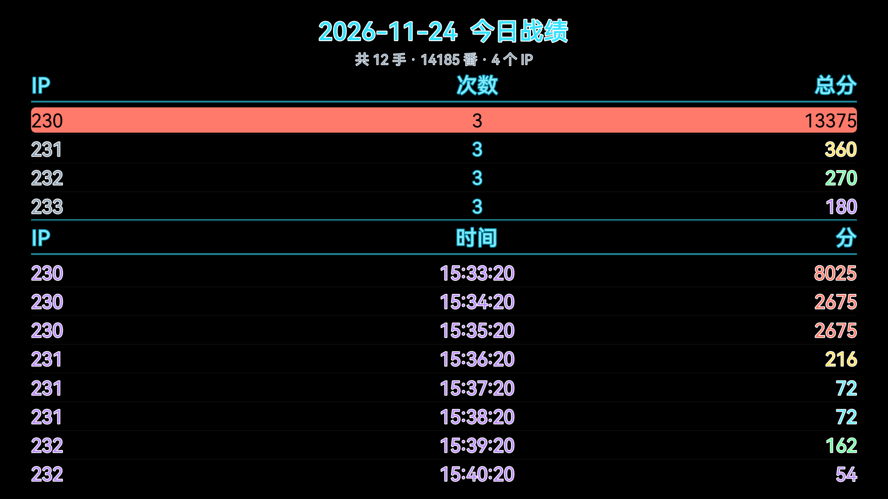
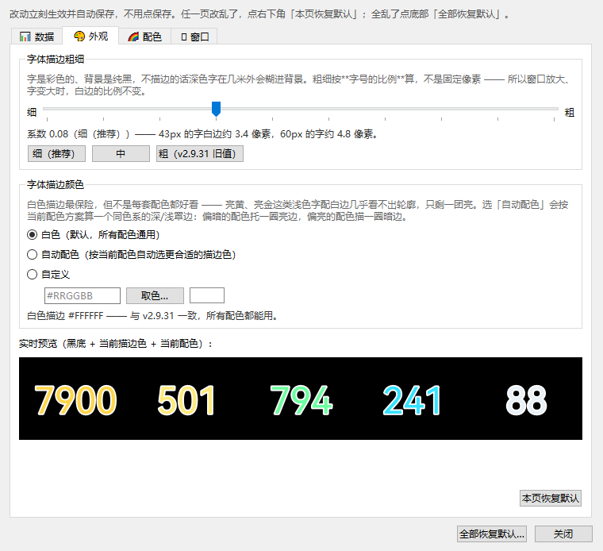
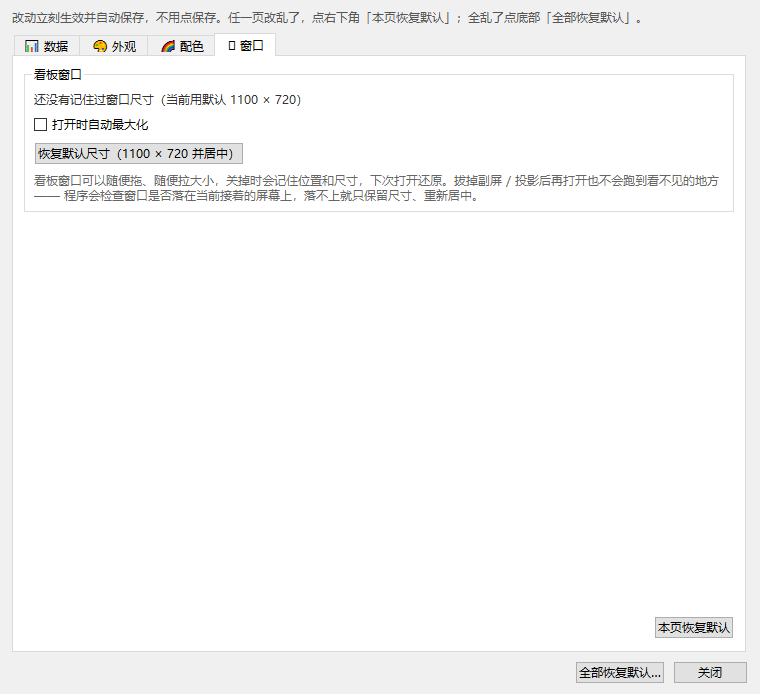
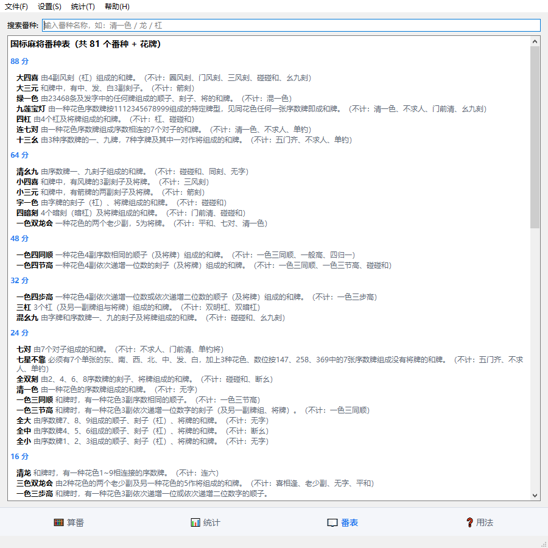

# 国标麻将算番器 · 完全使用手册 - v2.9.35

**从零基础到高级应用 · 全职业全场景指南**

> 一个纯本地、不联网、不赌博的国标麻将算番工具。
> 点牌 → 出番数、番种、起和判定、听牌候选；再送一块能投到电视上的大屏战绩看板。

---

## 先看一眼它长什么样

<table>
<tr>
<td width="50%" align="center">

**主界面（算番页）**
一手九莲宝灯，共 106 番


</td>
<td width="50%" align="center">

**统计页**
按 IP（人）聚合 + 最近记录


</td>
</tr>
</table>

<table>
<tr>
<td width="50%" align="center">

**大屏看板 · 经典配色**
投到电视上，几米外看得清


</td>
<td width="50%" align="center">

**大屏看板 · 彩虹配色 + 自动描边**
4 人一桌各占一色



</td>
</tr>
</table>

**上墙设置（四页标签）**

<table>
<tr>
<td align="center"><b>📊 数据</b><br></td>
<td align="center"><b>🎨 外观</b><br></td>
<td align="center"><b>🌈 配色</b><br></td>
<td align="center"><b>🪟 窗口</b><br></td>
</tr>
</table>

<table>
<tr>
<td width="34%" align="center">

**番种表（81 番种）**
每个番种都有定义与例牌



</td>
<td width="30%" align="center">

**应用设置**
读番 / 统计列 / Web 版 / 高级


</td>
<td width="36%" align="center">

**用法说明页**
软件内置的图文帮助


</td>
</tr>
</table>

> 全部截图都在仓库的 [`截图/`](截图/) 目录里，是程序真实截图（不是手绘示意图），
> 由 `_scaffold/_doc_shots.py` 一键生成，可自行复现。

---

## 你是哪一类人？—— 按身份选入口

这份手册很长（因为它要同时照顾完全不懂电脑的人和要二次开发的程序员）。
**先按你的身份找到入口，不用从头读到尾。**

| 你的身份 | 从哪开始读 | 大概要多久 | 你会拿到什么 |
| --- | --- | --- | --- |
| 🧓 **完全不懂电脑的人** | [1.3](#13-第一次打开你看到什么) → [1.4](#14-最短路径算一手牌30-秒) | 5 分钟 | 会点牌、会看番数 |
| 🀄 **麻将爱好者 / 玩家** | [第二部分](#第二部分--给麻将爱好者算番器能帮你做什么) | 15 分钟 | 会复盘、会验证自己的算番、会练听牌 |
| 🏠 **家里有投影 / 电视，想投战绩** | [3.8.1 统计页](#381-统计页--v2919-新增) → [3.8.1 大屏看板](#3811-大屏看板把当天成绩投到电视--投影上--v2931-新增) → [3.8.1 网页版](#3812-网页版看板--v2935-新增电视盒子直接开浏览器) | 20 分钟 | 一块能挂在墙上的实时战绩牌 |
| 📱 **只想用手机 / 平板看** | [第四部分 · Web 版](#第四部分--给手机平板用户web-版使用手册) | 10 分钟 | 手机浏览器直接算番 |
| ⚖️ **裁判 / 教练 / 赛事组织者** | [第六部分 · 专业算番口径](#第六部分--给裁判教练赛事组织者专业算番口径) | 30 分钟 | 敢在比赛现场用的口径依据 |
| 💻 **程序员 / 想集成到自己程序** | [第五部分 · 三种调用方式](#第五部分--给程序员三种调用方式) | 20 分钟 | Python import / 命令行 / HTTP 三种接口 |
| 🔧 **运维 / IT / 要在局域网部署** | [第七部分 · 部署](#第七部分--给运维it部署局域网统计打包) | 20 分钟 | 端口、口令、防火墙、打包全流程 |
| 🧪 **测试 / 研究者** | [第八部分 · 全量校验](#第八部分--给研究者测试工程师全量校验与错误注入) | 20 分钟 | 1049 项自动化验证怎么跑 |
| 🛠 **维护者 / 想改代码** | [第九部分 · 代码地图](#第九部分--给维护者代码地图与二次开发) | 40 分钟 | 每个模块管什么、从哪里改 |
| 🆘 **遇到问题了** | [第十部分 · 常见问题](#第十部分--常见问题按人群分类) | 按症状查 | 现象 → 原因 → 解决 |
| 📜 **只想知道这版改了什么** | [第十一部分 · 版本更新简介](#第十一部分--版本更新简介从-v10-到-v2935) | 3 分钟 | 每版一句话变更 |

---

| 项目 | 内容 |
| --- | --- |
| 软件名称 | 国标麻将算番器（英文名：Mahjong_Calculator） |
| 作者 | 杜玛 |
| 版权 | © 永久 杜玛 保留所有权利 |
| 开源许可证 | AGPL-3.0 |
| 项目地址 | https://github.com/duma520/Mahjong_Calculator |
| 作者主页 | https://github.com/duma520 |
| 问题报告 | 通过 GitHub Issues 提交 |
| 邮箱 | 不提供 |
| 技术支持 | 全部通过公开渠道（GitHub Issues），以便其他用户也能受益 |
| 本文档日期 | 永久 |
| 当前软件版本 | 2.9.35（2026-11-24） |

> **版权声明**：本文档内容未经书面许可不得转载或用于商业用途。本文档随软件以 AGPL-3.0 许可证发布，但文档本身的转载与商业使用需获得作者书面许可。
>
> **注意**：我们不提供私人邮箱支持，所有技术支持都通过公开渠道进行，以便其他用户也能受益。

---

## 目录

- [第一部分 · 给完全不懂的人：5 分钟上手](#第一部分--给完全不懂的人5-分钟上手)
- [第二部分 · 给麻将爱好者：算番器能帮你做什么](#第二部分--给麻将爱好者算番器能帮你做什么)
- [第三部分 · 给普通用户：桌面版完整操作手册](#第三部分--给普通用户桌面版完整操作手册)
- [第四部分 · 给手机/平板用户：Web 版使用手册](#第四部分--给手机平板用户web-版使用手册)
- [第五部分 · 给程序员：三种调用方式](#第五部分--给程序员三种调用方式)
- [第六部分 · 给裁判/教练/赛事组织者：专业算番口径](#第六部分--给裁判教练赛事组织者专业算番口径)
- [第七部分 · 给运维/IT：部署、局域网、统计、打包](#第七部分--给运维it部署局域网统计打包)
- [第八部分 · 给研究者/测试工程师：全量校验与错误注入](#第八部分--给研究者测试工程师全量校验与错误注入)
- [第九部分 · 给维护者：代码地图与二次开发](#第九部分--给维护者代码地图与二次开发)
- [第十部分 · 常见问题（按人群分类）](#第十部分--常见问题按人群分类)
- [第十一部分 · 版本更新简介（从 v1.0 到 v2.9.35）](#第十一部分--版本更新简介从-v10-到-v2935)
- [第十二部分 · 术语表与索引](#第十二部分--术语表与索引)
- [附录 A · 81 番种速查表](#附录-a--81-番种速查表)
- [附录 B · 文件清单与目录结构](#附录-b--文件清单与目录结构)
- [附录 C · 全部快捷键与命令行参数](#附录-c--全部快捷键与命令行参数)
- [附录 D · 全部设置项一览](#附录-d--全部设置项一览)
- [附录 E · 联系与贡献](#附录-e--联系与贡献)

---

# 第一部分 · 给完全不懂的人：5 分钟上手

## 1.1 这个软件是什么？

一句话：**它是一台「麻将算番翻译机」**。

你打国标麻将（也叫竞技麻将、中国麻将竞赛规则麻将），和了一手牌，但不确定这手牌到底值多少分、算哪些番种——把牌点进这个软件，它立刻告诉你：

- 这手牌**共多少番**；
- 由**哪些番种**组成，每个番种多少分；
- 够不够**起和**（国标规定 8 分起和）；
- 还差几张、**听哪几张**牌、每张听牌各是多少番。

它不会替你打牌，不会出老千，不联网、不赌博、不收集你的隐私。它就是一个**算分工具**——像计算器，只不过算的是麻将番数。

## 1.2 它和「麻将 App」有什么不同？

| | 普通麻将 App | 本软件 |
| --- | --- | --- |
| 目的 | 打牌、娱乐、对局 | **只算番**（不洗牌、不发牌、不对局） |
| 规则 | 地方规则五花八门 | **严格按 1998 年国家体育总局《中国麻将竞赛规则（试行）》** |
| 数据 | 上传服务器 | **全部本地**，不上传任何东西（除你主动开 Web 版给手机用） |
| 用途 | 玩 | 练习、教学、裁判、复盘、程序调用 |

## 1.3 第一次打开：你看到什么？

双击 `Mahjong_Calculator.exe`，会看到一个窗口，从上到下依次是：

```
┌──────────────────────────────────────────┐
│ 文件  设置  统计  帮助                    │  ← 菜单栏
├──────────────────────────────────────────┤
│ 牌选择区                                  │
│  [1索][2索][3索]...[9索]                  │  ← 第 1 行：索子
│  [1筒][2筒][3筒]...[9筒]                  │  ← 第 2 行：筒子
│  [1万][2万][3万]...[9万]                  │  ← 第 3 行：万子
│  [东][南][西][北][中][发][白]             │  ← 第 4 行：字牌
├──────────────────────────────────────────┤
│ [重置] 模式 [立牌][吃][碰][明杠][暗杠]    │  ← 模式行
├──────────────────────────────────────────┤
│ □自摸 □和绝张 □抢杠和 □海底捞月 □读番    │  ← 选项第 1 行
│ ○东风圈 ○南风圈 ○西风圈 ○北风圈          │  ← 选项第 2 行
│ 风位 ○东风位 ○南风位 ○西风位 ○北风位     │  ← 选项第 3 行
│ 花牌: [春夏秋冬梅兰竹菊] 0 张             │  ← 选项第 4 行
├──────────────────────────────────────────┤
│ 已选牌                                    │
│  副露 （暂无吃碰杠）                       │
│  立牌 （请在牌选择区点牌）                 │
│  和张 （未指定，选满 13 张后自动提示）     │
│  花牌 （未选花牌，点上方 8 张小图即可）    │
├──────────────────────────────────────────┤
│ 听牌候选                                  │
│  （立牌满 13 张后自动列出）                │
├──────────────────────────────────────────┤
│ 算番结果                                  │
│  共 0 番                                  │
│  （番种列表）                              │
├──────────────────────────────────────────┤
│ 🧮 算番 | 📊 统计 | 📖 番表 | ❓ 用法      │  ← 底部导航（v2.9.19 起四页）
└──────────────────────────────────────────┘
```

下面是**真机截图**（不是示意图）—— 已经摆好一手九莲宝灯（共 106 番），
你可以对照着看每个区域在哪：


> 图里这手牌是 `1112345678999万` 和 `1万` = **九莲宝灯 88 番 + 清龙 16 番 + 四归一 2 番 = 共 106 番**。
> 注意看三处：牌选择区里「一万」角上有红点（立牌 3 张）+ 和张标记；
> 「已选牌」区把立牌、和张分开列出来；最下面「共 106 番」下面就是番种明细。

## 1.4 最短路径：算一手牌（30 秒）

假设你手上是这 14 张牌：

```
1万 2万 3万 | 4万 5万 6万 | 7万 8万 9万 | 1筒 1筒 1筒 | 东 东
```

（也就是：万子清龙 + 一筒刻子 + 东东作将）

**操作步骤**：

1. **点牌**：在「牌选择区」左键点 `1万`、`2万`、`3万`、`4万`、`5万`、`6万`、`7万`、`8万`、`9万`、`1筒` 三下、`东` 两下。  
   每点一下，牌上会出现圆点显示已选张数（立牌＝红色）。
   一张牌如果同时算进多类（立牌 / 暗杠 / 明杠 / 碰 / 吃 / 胡牌），会并排好几个不同颜色的圆点。

2. **选满 13 张**：这时你选了 13 张（因为第 14 张是「和张」）。

3. **看听牌候选**：软件自动列出你能和的牌，并标出每张的番数。

4. **点和张**：点一个候选牌（比如 `9万`），或者直接在牌池里点那张牌——它就被设为「和张」。

5. **看结果**：结果区显示 `共 XX 番` 和番种列表。

**就这么简单。**

## 1.5 三个最容易踩的坑

| 坑 | 正确做法 |
| --- | --- |
| 点了牌不知道怎么减 | **右键**点那张牌；或点下面「已选牌」里的那张；**牌上的圆点只是显示张数，点它不再减牌** |
| 点了「碰」想取消 | **再点一次「碰」按钮**，就回到「立牌」了 |
| 手上有暗杠不知道怎么选 | 先点「暗杠」按钮，再点那张牌（点一下自动补 4 张），显示为「面·背·背·面」 |

## 1.6 它不能做什么？

- **不能**自动帮你打牌（它没有 AI 出牌功能）；
- **不能**保证你赢（它只算分）；
- **不能**代替正式裁判（正式比赛以裁判判定为准）；
- **不能**识别照片里的牌（你得手动点）；
- **不能**告诉你「这张该不该打」（没有策略建议）。

---

# 第二部分 · 给麻将爱好者：算番器能帮你做什么

## 2.1 为什么需要算番器？

国标麻将（竞技麻将）有 **81 个番种**，分 **12 个分值级**（88/64/48/32/24/16/12/8/6/4/2/1），还有一堆「不计」规则（比如「大三元」不计「箭刻」，「四暗刻」不计「门前清」和「碰碰和」）和「必然并存」逻辑。

**人脑算番的三大痛点**：

1. **算漏**：明明有「三色三同顺」，却忘了算；
2. **算重**：把「不求人」和「自摸」都算上了（其实不求人已含自摸，不重复计）；
3. **算错**：把「边张」在听两张牌时也算上（规则规定听两种及以上不算边/坎/钓）。

算番器把这三件事全解决了：

- 它枚举**所有可能的牌型分解**，逐个算番，取最高分（就高不就低原则）；
- 它读规则 JSON 里的「不计」字段，自动去重；
- 它按 1998 年领队会规定判断单听/多听，只对单听算边坎钓。

## 2.2 场景一：练习时验证自己的算法

**例如**：你手上是

```
1索 2索 3索 | 4索 5索 6索 | 7索 8索 9索 | 东 东 东 | 中 中
```

你自己算：清一色？不对，有字牌；混一色？对；清龙？对，1-9 索；三风刻？不对，只有一个东刻……你可能算出 6+16=22 番。

**用算番器**：输入后它告诉你实际是 **26 番**（混一色 6 + 清龙 16 + 门前清 2 + 无字？不对，有字牌……）。你会发现漏算了某些东西。

> **练习建议**：每次练习后都点一遍算番器，对比自己算的和软件算的，一个月后你对番种的敏感度会大幅提升。

## 2.3 场景二：复盘时搞清楚「这手为什么分低」

**例如**：你打了半天和了个「碰碰和」，结果只有 6 分，不够 8 分起和，白和了！

**用算番器**：输入后它明确告诉你「番种合计 6 分，未达 8 分起和标准」——并且列出你差在哪。

**再例如**：你听牌了，但不知道听哪张分最高。

**用算番器**：选满 13 张，它会**列出所有听牌候选，每张标出番数**，你可以据此选最有利的听牌。

## 2.4 场景三：教学时给学生演示

如果你在教别人打国标麻将，算番器是最好的教具：

- 点出一手牌，让学生先自己算，再点「算番」验证；
- 用「番表」页查任意番种的定义和「不计」关系；
- 用「用法」页给学生讲算番口径（起和分、花牌、单听等）。

## 2.5 场景四：钻研罕见牌型

有些牌型你一辈子也摸不到几次，但算番器可以让你随时研究：

- **九莲宝灯**（88 番）：同一花色 1112345678999 + 任意一张；
- **连七对**（88 番）：同一花色序数相连的 7 个对子；
- **十三幺**（88 番）：13 种幺九牌各一张 + 其中任意一张作将；
- **一色双龙会**（64 番）：同花色 123、123、789、789 + 5 作将；
- **组合龙**（12 番）：三门花色按 147/258/369 排列的 9 张。

在牌池里点出这些牌，看看算番器怎么算。

## 2.6 场景五：比赛前熟悉规则细节

国标麻将有大量细节容易搞错：

| 常见误区 | 正确规则 |
| --- | --- |
| 「天和」「地和」也算番 | **国标不设天和/地和/人和**（《问答》Q12） |
| 花牌算进 8 分起和分 | **花牌每张 1 分，但不计入起和分** |
| 听两张牌和其中一张算「边张」 | **听两种及以上不算边/坎/钓** |
| 明杠、暗杠都算 1 分 | **明杠 1 分、暗杠 2 分；一明一暗 = 6 分** |
| 「不求人」和「自摸」都算 | **已计不求人不再计自摸**（不求人含自摸） |
| 七对不能含 4 张相同的牌 | **国标允许 4 张算两对**（v2.2.1 修正） |

算番器已按这些正确口径实现，你可以拿它当「规则检查器」。

---

# 第三部分 · 给普通用户：桌面版完整操作手册

## 3.1 菜单栏

菜单栏有四项：

### 3.1.1 文件(&F)

- **退出(&Q)**（Ctrl+Q）：关闭程序。关闭时会自动保存所有设置。

### 3.1.2 设置(&S)

**点一下就弹出设置窗口**（不是下拉菜单）。快捷键 **Ctrl+,**。

设置窗口有四个标签页：

| 标签页 | 内容 |
| --- | --- |
| **读番** | 「默认开启自动读番」复选框、读番语音包下拉、试听按钮、读番说明 |
| **统计列** | 统计面板显示哪些列（13 个复选框）、明细面板显示哪些列（14 个复选框）。★ **这里是所有设备的唯一开关**：改完，手机 / 平板（Web 版）刷新页面就跟着变（v2.9.21 起）。★ v2.9.22 起同样的事可以在**统计页工具栏的两个「…表列 ▾」按钮里直接勾**，两处改的是同一份设置。★ v2.9.27 起本页最下面还有「记录方式 → 同一手牌 3 分钟内只算一条」的开关（默认勾着，取消＝算一次记一条） |
| **Web 版** | 启动 Web 版、启动程序时自动开启、允许局域网访问、端口/口令/免口令/页面按钮/地址与用法按钮 |
| **高级** | 版本信息、番种数、设置文件路径、读番音频目录、打开程序目录、重置所有设置 |

设置**改动即时生效并自动保存**——没有「确定/取消」，只有「关闭」。

### 3.1.3 统计(&T)

查看所有用户的算番统计（含手机/平板 Web 端、桌面端本地）。按天聚合，可看逐手明细。

### 3.1.4 帮助(&H)

- **用法说明(&H)**：切换到「用法」页；
- **番种表(&T)**：切换到「番表」页；
- **关于(&A)**：显示版本信息。

## 3.2 牌选择区

四行牌，从左到右依次是：

| 行 | 牌 |
| --- | --- |
| 第 1 行 | 1索 ~ 9索（T1~T9） |
| 第 2 行 | 1筒 ~ 9筒（B1~B9） |
| 第 3 行 | 1万 ~ 9万（W1~W9） |
| 第 4 行 | 东 南 西 北 中 发 白（F1~F4, J1~J3） |

**操作方法**：

| 操作 | 效果 |
| --- | --- |
| **左键单击** | 加一张（最多 4 张） |
| **右键单击** | 减一张 |
| **点下面「已选牌」里的某一张** | 取消这一张（手机/触屏友好） |
| **点牌上的圆点** | **不再减牌**（v2.8.0 起取消，点在上面等于点这张牌） |

**彩色圆点**（v2.9.18 起）：显示这张牌在各类里各有几张，颜色区分归属——
**立牌＝红**、**暗杠＝紫**、**明杠＝橙**、**碰＝蓝**、**吃＝绿**、**胡牌＝金**（金字配深色字）。
同一张牌同时算进多类时会**并排好几个圆点**，各显示自己的张数；
圆点放不下时自动缩小（20 → 16 → 13px）、一行最多两个，再多换第二排。

**蓝色边框**：表示这张牌已被选中（至少有 1 张）。

## 3.3 模式行

从左到右：`[重置]` `模式` `[立牌]` `[吃]` `[碰]` `[明杠]` `[暗杠]`

### 3.3.1 立牌（默认）

手上还没亮明的牌，也就是「门前暗手牌」。

- 直接左键点牌即可加；
- 立牌满 `13 - 3×副露数` 张时，软件自动列出听牌候选。

### 3.3.2 吃

**先点「吃」按钮，再依次点出 3 张相连的同花色牌**。

例如：点 `1万`、`2万`、`3万`，软件自动组成一个吃（顺子）。

- 只能吃同花色的顺子（数字连续）；
- 点错了一张可以右键撤销最后一张；
- 已经用掉 4 张的牌不能再吃（吃进去的那三张各算 1 张）；
- **再点一次「吃」按钮** = 取消该模式。
> **★ v2.9.30 修的一个老 bug（吃碰杠的张数）**：吃出来的三张是**三张不同的牌**，
> 早先版本却把它们都记成「第一张用了 3 张」，于是——
>
> - 吃 `1万2万3万` 之后再想**碰 `1万`**，会被误报「这种牌最多 4 张」而点不动（其实只 4 张，合法）；
> - 反过来吃 `1万2万3万` 之后再想**杠 `2万` 或 `3万`**，却又能杠成（实际 5 张，不合法）。
>
> 现在两边口径都改成「逐张各算 1 张」，并且**软件里能点出来的牌型，一定是合法的**。
> 如果你以前因为「点不了」而绕开过某种碰法，这一版可以正常用了。

### 3.3.3 碰

**先点「碰」按钮，再点要碰的牌**。点一下自动补足 3 张。

例如：点 `东`，软件自动组成 `东东东` 刻子。

### 3.3.4 明杠

**先点「明杠」按钮，再点要杠的牌**。点一下自动补足 4 张，显示为 4 张正面。

### 3.3.5 暗杠

**先点「暗杠」按钮，再点要杠的牌**。点一下自动补足 4 张，显示为「面·背·背·面」（中间两张用牌背图）。

> **重要**：暗杠不影响「门前清」，明杠影响「门前清」。

### 3.3.8 吃碰杠的「最多 4 张」是怎么判的

四种牌各有 4 张，软件在三个地方都会拦：

| 操作 | 判据 | 超了会怎样 |
| --- | --- | --- |
| 立牌点一张 | 这种牌已用张数 < 4 | 状态栏提示「这种牌最多 4 张」 |
| 碰 / 明杠 / 暗杠 | 已用张数 + 3（或 4）≤ 4 | 同上，副露不会加上去 |
| 吃 | 这三张各自 +1 后都 ≤ 4 | 同上，三张一起作废、要重新点 |

「已用张数」= 立牌张数 + 所有副露里**逐张**的张数 + 和张（如果有）。
所以吃 `1万2万3万` 之后再碰 `1万` 是合法的（1+3=4 张），杠 `2万` 就不合法（1+4=5 张）。

**极限组合也能做**：`吃 1万2万3万` + `碰 1万` + `碰 2万` + `碰 3万`，四组副露正好把三种牌各自的 4 张**全部用光**。
先吃后碰、先碰后吃两种顺序都通，之后还能再立 1 张、点 1 张当和张 —— 正好 14 张，软件照常算番。
（v2.9.30 已逐项断言钉住，桌面端 20 项、手机端 13 项全过。）

> 唯一还会拦你的是**「副露最多 4 组」** —— 这是麻将规则本身的上限（4 组副露 + 1 张将牌 = 14 张），不是软件的 bug。
> 想再加第 5 组时，状态栏会提示「副露最多 4 组」。

### 3.3.6 重置

**全部复位**：手牌、副露、和张、待选、模式、花牌、四个选项复选框、圈风、风位——全部回到初始状态，并立即保存。

> **注意**：「重置」**不会**取消「读番」勾选（那是偏好设置，不是这一手牌的状态）。

> ★ **v2.9.25：手机上的「重置」是红色的**。桌面端这个按钮是浅橙底深橙字；Web 客户端（手机/平板）上它是**红底白字加粗**（`#c0392b` 背景 + 白字，对比度 5.44:1），按住还会变深一档 —— 因为它清空的是整手牌，挨着蓝色「立牌」时橙蓝两色容易看混，改红就是为了**别再点错**。位置没变，仍是「立牌」左边。

## 3.4 选项区（四行）

### 3.4.1 第 1 行：复选框

| 复选框 | 含义 |
| --- | --- |
| **自摸** | 自己抓牌成和 |
| **和绝张** | 和的这张牌，牌池中只剩最后一张 |
| **抢杠和 / 杠上开花** | 勾选自摸时变「杠上开花」，未勾选时是「抢杠和」 |
| **海底捞月 / 妙手回春** | 勾选自摸时变「妙手回春」，未勾选时是「海底捞月」 |
| **读番** | 算完番把总番念出来（合计 N 番） |

> **动态文案**：勾上「自摸」后，第 3、4 个复选框自动变成「杠上开花」「妙手回春」；取消「自摸」后变回「抢杠和」「海底捞月」。切换时会清空旧勾选，避免误算。

### 3.4.2 第 2 行：圈风

`○东风圈` `○南风圈` `○西风圈` `○北风圈`（互斥单选）

### 3.4.3 第 3 行：风位

`风位` `○东风位` `○南风位` `○西风位` `○北风位`（互斥单选）

> **圈风、风位任何时候都可以点**，点了立刻重算。

### 3.4.4 第 4 行：花牌

`花牌:` `[春][夏][秋][冬][梅][兰][竹][菊]` `N 张`

- 点一下小图选中，再点取消；
- 每张花牌 1 分，**但不计入 8 分起和分**；
- 花牌不占 14 张手牌。

## 3.5 已选牌区

四行：**副露 / 立牌 / 和张 / 花牌**。

**每一行都可以点击取消**：

| 点哪一行 | 效果 |
| --- | --- |
| 副露里点一张 | **撤销那一组**（吃/碰/杠） |
| 立牌里点一张 | 减一张 |
| 和张里点一下 | 取消和张 |
| 花牌里点一张 | 取消那张花牌 |

下方有一行蓝色提示，告诉你还差几张 / 听几张 / 和张是谁。

## 3.6 听牌候选区

立牌选满（13 − 3×副露数）张时**自动列出**。

- 每个候选牌上方标该张的**总番数**；
- 不足 8 分标红（起和不够）；
- **点击即设为和张**并立刻出结果。

## 3.7 算番结果区

- **共 N 番**（大字）；
- 不足 8 分标红并提示；
- 番种列表（`N番  番种名`）；
- 牌型说明；
- **🔊 读番**按钮（随手念当前结果）。

## 3.8 底部导航

`🧮 算番` | `📊 统计` | `📖 番表` | `❓ 用法`（★ v2.9.19 起四页，「统计」插在算番与番表之间）

**每页有自己的宽度**（★ v2.9.22）：切页时窗口只改**宽度**、不动高度和位置 —— 算番页 **680**、
统计页 **1180**、番表页 **900**、用法页 **880**。你在某一页把窗口拖宽过，这一页就记住拖后的宽度
（只影响这一页，不影响别的页），下次启动照样按记下的宽度来；窗口最大化 / 全屏时不改尺寸。
宽度记在 `mahjong_settings.json` 的 `page_widths` 里。

### 3.8.1 统计页（★ v2.9.19 新增）

**干什么用**：局域网里别人用手机 / 平板算的手，在这页**实时**看得见；看错了能当场改，重复记了能当场删。

**界面从上到下**：

| 控件 | 作用 | 取值 / 说明 |
|---|---|---|
| **日期** | 只看某一天 | 首项「全部日期」，其余按天倒序（数据来自 `mahjong_stats.db`） |
| **范围** | 只看某一端 | 全部端 / 只看 Web 端 / 只看桌面端 |
| **刷新** | 立刻重读一次 | 平时不用点，勾了实时刷新自己会动 |
| **实时刷新** | 每 2 秒查一次库 | 默认勾上；**只在本页生效**，切到算番页会自动停（不占 CPU） |
| **汇总行** | 共 N 手 / N 番 / N 人 | 后面跟一句「其中 Web 端 …手（…番）、桌面端 …手（…番）」 |
| **番种行** | 番种榜 | 「清龙×71、九莲宝灯×65…等 N 种」，空库时提示还没有记录 |
| **按人表列 ▾（N）** | 勾这张表显示哪几列 | ★ v2.9.22 新增。共 13 列可选；勾完立刻重排表格并**自动保存**，「至少留一列」有兜底 |
| **记录表列 ▾（N）** | 勾「最近记录」显示哪几列 | ★ v2.9.22 新增。共 14 列可选，默认 8 列；同样勾完即生效、即落盘 |
| **明细表列 ▾（N）** | 勾「逐手明细」显示哪几列 | ★ v2.9.23 新增。共 14 列可选，默认全开；它也同时是所有 Web 客户端明细表显示的列 |
| **📺 大屏看板** | 开一个独立的黑底窗口投到大屏 | ★ v2.9.31 新增。上半每 IP 一行（次数 / 总分）、下半最近 N 手（时间 / 分数）；详见本节末尾。★ v2.9.32 加上四页标签设置、描边粗细与颜色可调、241 套配色、窗口记忆；★ v2.9.33 分档改成按名次 + 榜首整行反色高亮；★ v2.9.34 新增「彩虹」配色；★ v2.9.35 增加网页版（电视盒子直接开浏览器看，不用投屏） |
| **按人聚合**表 | 每人一行 | 默认 用户 / 昵称 / 客户端 / 合计番数 / 次数 / 达标 / 最近 / 番种；**双击**看这个人的逐手明细 |
| **最近记录**表 | 每一手一行 | 默认 时间 / 昵称 / 客户端 / 番数 / 起番 / 达标 / 番种数 / 番种 |
| **编辑选中…** | 改一条判定 | 只能改 **番数 / 起番 / 达标 / 番种数**；时间、用户、IP、UA 属事实不让改 |
| **删除选中…** | 删一条 | 二次确认，删了不可撤销 |
| **删除此人全部…** | 清一个人 | 二次确认；**这个人的昵称也会一起释放**，下次同名不会变成「老张#2」 |
| **清理重复…** | 合并历史重复记录 | ★ v2.9.26 新增。先预览「共 N 条 → 保留 K 条、删 M 条」，确认后才删；时间窗默认 120 秒 |
| **右键（三张表 / 日期下拉）** | 快捷查看·复制·删除 | ★ v2.9.26 给「最近记录」加了右键；★ v2.9.28 补齐另外两张：**按人聚合**右键 → 看逐手明细 / 复制 IP / 复制昵称 / 删除此人全部 / 删除这一天 / 清理重复；**逐手明细**右键 → 复制这一条 / 复制番种 / 编辑这一条 / 删除这一条 / 删除这一天。日期下拉右键 → 删那一天的记录 |

**注意**：番种名是从番型推出来的，**手改会与番数对不上**，所以编辑框里番种是只读的。


> 上面是统计页的真实截图（1180×900）。顶部那一行是工具栏：日期下拉、「范围」下拉、
> 刷新、清理重复…、三个「列 ▾」按钮、📺 大屏看板、🌐 Web 看板地址、实时刷新勾选。
> 中间两张表：**按人聚合**（每人一行）与**最近记录**（每手一行）。

**显示哪几列**（★ v2.9.21 归口，★ v2.9.22 起可页面内直接改）：两处入口，改的是同一份设置 ——

1. **就在这一页改**（最常用，★ v2.9.22 起）：点工具栏的「按人表列 ▾（N）」「记录表列 ▾（N）」
   「明细表列 ▾（N）」（★ v2.9.23 新增第三个），勾上 / 取消一列，表格**立刻**重排、并自动写进
   `mahjong_settings.json`；菜单里还有「全选」「恢复默认」（按人表与明细表另有一键「手机常用」）。
   去掉最后一列会被拦住（至少留一列）。

   **明细窗口里也能改**（★ v2.9.23）：打开「逐手明细」后，标题下面同样有一个「明细表列 ▾（N）」——
   那个窗口是模态的、会挡住统计页工具栏，所以它自己带一个。两处改的是**同一份**设置。
2. **在设置里改**：「菜单 → 设置 → 统计列」，同一份清单，改完这一页也立刻跟着变。

**「按人表列」同时也是所有 Web 客户端的唯一来源** —— 手机 / 平板上的那张表按这几列显示，
**刷新一下就跟着变**；手机端只能看、改不了（详见 5.x Web 版设置）。「统计列」页里还有两个
「手机常用」按钮，一键回到手机上看得清的那 11 列 / 10 列。

**★ v2.9.24 修掉的两个列 bug**（如果你被这两个坑过，这一版就是为你修的）：

1. **勾掉的列重启后又自己长回来。** 以前程序启动时会「自动补新列」—— 老版本升级时确实需要它，
   但它分不清「你这台机器还没有这个字段」和「你主动把它勾掉了」，于是你删到 5 列、重开又变 9 列。
   现在**一律尊重你的勾选**：删掉就是删掉，重启、换天、升级都不复活。想加回来，就在「按人表列 /
   记录表列 / 明细表列」菜单里重新勾上（或点「恢复默认」一键回到推荐列）。
2. **手机 / 平板上表头与数据可能错列。** 以前手机页面的表头是「按列清单的定义顺序」画的，
   数据是「按你设置的顺序」填的 —— 只要两者不一致（比如你把 IP 提到前面），整张表就错位，
   标题写着「IP」、格子里却是「番数」。现在表头与数据**用同一个顺序**，你在电脑上怎么排，
   手机 / 平板上就一模一样 —— **列序完全由你决定，程序不再自作主张**。
**★ v2.9.26：同一次算番不再重复入库 + 老记录一键清理**

以前**每点一次重新计算、改一个选项，都会往库里多写一条**。同一手牌来回试选项几分钟，统计里就多出十几条，
合计番数虚高得离谱 —— 实测你的库里 455 条记录，其中 2026-11-05 一手牌在 9 秒内写了 10 条、
2026-11-21 一手牌在 6.5 分钟里写了 24 条。这一版从两头治：

1. **以后不再产生重复**：每手牌都有个「指纹」（牌 + 副露 + 和张）。**同一指纹 3 分钟内再算，就地改那一条**，
   不新增；番数更新成你最后看到的那个数（改选项后番数变低，库里也变低 —— 和你屏幕上一致）。
   真要连打两把一样的牌？换牌或隔 3 分钟以上就算新的一手（窗口自 v2.9.27 起从 10 分钟收窄到 3 分钟，见下）。
2. **老记录一键清理**：工具栏点「清理重复…」，先出预览 —— 同一个人、同一天、相邻两条间隔不超过
   **120 秒**的归成一组，每组只留**番数最大**的那一条（并列留时间较晚的）。预览表逐组列出
   「日期 / 是谁 / 这一组删几条 / 保留几番 / 少算几番」，看清楚了再点「开始清理」。
   时间窗可调 10~1800 秒：**调小**更保守（可能留点重复），**调大**删得更干净（但可能误删真连打的几手）。
   清理**不可撤销**，且每组一定留一条 —— 清理后每人每天至少还有记录。
   实测你的库用 120 秒能把 455 条压到 54 条。
3. **删某天**：记错了想整天重来 —— 在左上角「日期」下拉上**右键** → 「删除 YYYY-MM-DD 的全部记录」；
   或在「最近记录」表上右键 → 「删除这一天」。删某天**不释放昵称**（那天的人别的日子还有记录）。

**★ v2.9.27：3 分钟窗口 + 一个可以关掉的开关**

v2.9.26 用的是 10 分钟窗口，太宽了：实测一次算番折腾很少超过 3 分钟，
于是**同一手牌隔了 5 分钟真的又和了一次，会被误当成同一条**，被吃掉一手。所以这一版做了两件事：

1. **窗口从 10 分钟收窄到 3 分钟**（`SAME_HAND_UPSERT_MS = 180000`）。3 分钟内改选项重算仍然就地更新，
   隔得更久就老老实实算新的一手。
2. **做成开关**：「菜单 → 设置 → 统计列」页最下面新增「记录方式」区，
   勾选框写着「同一手牌 3 分钟内只算一条（改选项重算就地更新）」，**默认勾着**。
   - 勾着＝上面的合并行为（推荐，日常就用这个）。
   - 取消勾选＝退回老行为：**算一次记一条，不做任何合并**。
     核对数据、想看每一步重算的结果时临时关掉它；关掉期间同一次算番会写很多条，
     很容易把「次数」和「合计番数」撑大 —— **查完记得勾回来**。
3. 关开关**不会删任何已有数据**，也不会影响「清理重复…」（那是另一套历史清理逻辑，按时间窗在对话框里临时定）。
   关掉期间写下的那几条，勾回来以后也不会被自动合掉 —— 要清就点「清理重复…」。

**★ v2.9.28：三张表都能右键 + 「日期 / 范围」会记住**

以前只有「最近记录」表能右键，另外两张要操作得先选中、再跑去别处按按钮；统计页每次重启也都跳回
「全部日期 / 全部端」，想盯某一天就得每次重新选。这一版把这两件事都补上了。

**1. 三张表的右键菜单**（哪里都能右键，不用先跑一趟按钮）：

| 在哪张表上右键 | 能做什么 |
|---|---|
| **按人聚合** | 看逐手明细… ／ 复制 IP ／ 复制昵称 ／ 删除此人在当前范围的全部记录… ／ 删除「这一天」的全部记录… ／ 清理历史重复… |
| **逐手明细**（双击某人打开的窗口里） | 复制这一条（时间 + IP + 番数 + 番种）／ 复制番种 ／ 编辑这一条… ／ 删除这一条… ／ 删除「这一天」的全部记录… |
| **最近记录** | 删除这一条… ／ 编辑这一条… ／ 删除「这一天」的全部记录… ／ 清理历史重复…（v2.9.26 就有） |

- 右键点在哪一行，就作用在**哪一行**（不是上一次选中的那一行）—— 这一点在删数据时最要紧。
- 「复制 IP / 复制昵称 / 复制番种」直接进系统剪贴板，状态栏（或明细窗口底部）会说一句「已复制…」。
  复制的是纯文本，粘到微信 / 记事本 / Excel 都能直接用。
- 「复制这一条」的格式是：`2026-11-22 01:30:12.345　192.168.x.x　106 番　清一色、门前清`。
- 「删除此人在当前范围」按**上面选的日期**删；范围是「全部端」时不分 Web / 桌面。

**2. 「日期」「范围」两个下拉会记住**：选过一次就写进 `mahjong_settings.json`，
重启程序、切去算番页再切回来，都还是你上次选的那一天 / 那一端。点「重置所有设置」才回到「全部」。
如果记着的那一天被删光了（比如你把那天的记录全删了），它会自动落回「全部日期」，不会卡在一个不存在的选项上。
**速度**：一次完整刷新约 **0.1 秒**（v2.9.20 之前是 49.8 秒 —— 表格列宽「按内容自适应」模式下
逐格填数据会退化成平方级，现在填之前临时关掉自适应、填完再恢复）。2026-11-21 实测 180 行 × 8 列：
修复前首切 48 s / 修复后 152 ms。

**★ v2.9.31：大屏看板（把当天成绩投到电视 / 投影上）**

统计页工具栏多了一个「**📺 大屏看板**」按钮。点开是**一个独立的黑底窗口**，专门给「放在牌桌旁、几米外看」这个场景做的 —— 字号大、白描边、背景纯黑，在电视 / 投影上不刺眼也不糊。

**看板长什么样**（照着一块手写板排的）：


> 上面这张是 1920×1080 的真实出图（经典配色、按名次分档、榜首整行反色高亮）。
> 下半区是最近 8 手，时间倒序。

```
┌──────────────────────────────────────────────┐
│              2026-11-24  今日战绩              │  ← 标题（亮青）
│            共 105 手 · 5071 番 · 3 个 IP       │  ← 副标题
│   IP          │      次数      │      总分     │  ← 表头：亮青细下划线
│   100         │       64       │     3304      │  ← 每 IP 一行，分越高颜色越亮
│   （未记录IP） │       34       │     1528      │
│   20          │        7       │      239      │
│ ════════════════════════════════════════════ │  ← 双线分区
│   IP          │      时间      │       分      │
│   100         │    20:00:05    │      257      │  ← 最近 N 手，时间倒序
│   20          │    19:30:15    │       37      │
└──────────────────────────────────────────────┘
```

**上半区**（每 IP 一行）：这一天的**次数**和**合计番数**。行数就是「当天实际有几个 IP 就几行」，不预留空行。**下半区**（最近几手）：时间 + 那一手的番数，默认显示最近 **10** 手。

**颜色**：背景纯黑；文字全部**带描边**（不描边的话深底上色差小、几米外根本看不清）；分数分五档 —— 亮金（榜首）→ 亮黄 → 亮绿 → 亮青 → 灰白（最低）。**刻意没用红色/橙色**做主色，深底上对比度不够。★ v2.9.32 起描边**粗细可调（默认变细）**、颜色可白/自动/自定义，配色方案 241 套 —— 详见本节下面的 v2.9.32 小节。★ v2.9.33 起分档默认改成**按名次**（4 人各占一色），榜首整行反色高亮 —— 详见下面的 v2.9.33 小节。

**不画竖网格线**：竖线在 4~8 米外会连成一片竖条纹，反而压住数字（用户那块手写板本来也只有横线没有竖线）。但**对齐严格保留** —— IP 左对齐、次数居中、总分右对齐，个位天然对齐，扫一眼就能比大小。

**按钮条**（窗口底部）：

| 按钮 | 作用 |
|---|---|
| **日期下拉** | 默认「**今天（YYYY-MM-DD）**」。也可选「全部日期」或库里其它日期 |
| **⚙ 上墙设置** | 打开设置窗口（见下） |
| **🔄 刷新** | 立刻重读一次（平时不用点，它自己每 2 秒刷新） |
| **⛶ 全屏** | 切全屏；全屏时按钮条自动隐藏，**F11** 也能切、**Esc** 退出全屏、**双击画面**也行 |
| **✕ 关闭** | 关掉看板（不影响主程序） |

**★ 为什么看板自己带日期、不跟着统计页跑**：因为这是「当天的数据」大屏。统计页默认停在「全部日期」，如果直接绑过去，投出来就是全部 **560 手 / 37,093 番**的历史，完全不是「今日战绩」。所以看板自己维护日期，默认今天；统计页切到某一天时看板才跟着变，选「全部日期」时不动它。

**★ v2.9.32：上墙设置改成四页标签 + 描边可调 + 241 套配色 + 窗口记忆**

v2.9.31 的看板能用了，但「⚙ 上墙设置」只有一页、描边粗细写死在代码里、配色只有一套、窗口大小每次重开都回到 1100×720。v2.9.32 把这四件事都改了。

**① 设置窗口分成 4 页标签**（设置项变多以后，一页挤不下）：

| 页 | 管什么 |
|---|---|
| **📊 数据** | 上墙 IP 勾选表 + 自定义备注名 / 最近 N 手 / IP 显示方式 / 三个显示开关 |
| **🎨 外观** | 字体描边**粗细**（滑块 + 细中粗三个快捷键）+ 字体描边**颜色**（白 / 自动 / 自定义）+ 实时预览 |
| **🌈 配色** | 241 套配色方案（搜索 + 分组列表）+ 自定义配色（自己填 5 个色存成有名字的方案） |
| **🪟 窗口** | 当前记住的尺寸 / 「打开时自动最大化」/「恢复默认尺寸」 |

每页右下角有「**本页恢复默认**」（只重置这一页），最底部有「**全部恢复默认…**」（二次确认，全归零）。这是「改乱了能一键救回来」的兜底。

   

> 四页的真实截图（从左到右：📊 数据 / 🎨 外观 / 🌈 配色 / 🪟 窗口）。

**② 描边粗细可调，默认变细了**

v2.9.31 的描边是按字号 14% 算的 —— 43px 的字描边就有 **6.02px** 宽，实机看着太粗、字被白边吃掉。v2.9.32 默认改成 **8%**（同一个字 3.44px），并且给了滑块（2%~20%）和三个快捷键：

| 快捷键 | 系数 | 43px 的字 | 说明 |
|---|---|---|---|
| **细（推荐）** | 0.08 | 3.44 px | 默认值，远看轮廓清楚、近看不糊 |
| 中 | 0.11 | 4.73 px | 投影仪偏亮时可以用 |
| 粗 | 0.14 | 6.02 px | 就是 v2.9.31 原来的效果，要粗可以调回来 |

粗细按**字号的比例**算，不是固定像素 —— 所以窗口放大、字变大时，白边的比例不变，不会变成一圈细线。

**③ 字体描边颜色：白 / 自动 / 自定义**

| 选项 | 行为 |
|---|---|
| **白色**（默认） | 所有配色都用白边。最保险，绝大多数配色都好看 |
| **自动配色** | **每一档字色各自算一个描边色**。白边跟字色差得太近（如纯白字、近白字）就换成同色系更深/更浅的边；白边本来就分得开的（如亮金、亮绿），保持白色不动 |
| **自定义** | 自己取一个色，全屏统一用它 |

**★ 为什么「自动」是按每一档字色各算，而不是整屏一个色**：一屏里同时有五档字色 + 表头 + 标题 + 次要说明文字。任何单一描边色都必然跟其中某一档撞色 —— 实测过整屏一色的方案，24 套精选里有 20 套的最优解都退化成中性灰，比白边还差。按档各算才能保证每一档都有清晰轮廓。

**★ 判据是 Lab 色差，不是亮度比**：一开始用 WCAG 亮度对比度判断「白边够不够」，结果把亮金色（`#FFD54A`，与白的 Lab 色差 **71.9**，白边清清楚楚）判成「需要换色」，换成了暗绿边 —— 实机一看字反而变细变脏。现在改用 **CIE Lab ΔE**：白边与字色的 ΔE ≥ **40** 就直接保白（白边本来就分得开），否则在同色系里逐级压暗/提亮，找到 ΔE ≥ **30** 且黑底对比度 ≥ **3.5** 的颜色；找不到就退回白色。**绝不跨色相**（试过按 ΔE 最大化挑，会把纯黑推成紫色、米白推成红色，大屏上像描错色）。

**实测效果**：241 套配色里只有 **35 套**会被改色，其余 205 套「自动 = 白色」行为完全不变。典型例子 —— classic 只有最暗那档 `#E8F0F8`（与白 ΔE 仅 7.4，白边等于没描）换成淡蓝边 `#7DA9D4`，另外四档全部保白；candy / traffic / lava / matrix 全 5 档保白。

**性能坑（已解决）**：自动配色每算一次色要试十几个候选，未缓存时全 5 档要 **3.0ms**，一帧 60 段文字就是 **36ms** —— 会把 v2.9.31 的性能优化全部白做。加了结果缓存（上限 512 条）后是 **0.0057ms/全 5 档**，一帧约 0.068ms，等于没开销。

**④ 241 套配色方案**

| 分类 | 数量 | 说明 |
|---|---|---|
| **精选方案** | 25 套 | 手工挑的，每档都实测过黑底对比度 ≥ 3.0（WCAG AA 大字标准）。如「经典（默认）」「黄金时代」「冰火」「森林」「海洋」「紫夜」「糖果」「落日」「翡翠」「极简黑白」「电报青」「熔岩」「薄荷」「樱花」… |
| **派生方案** | 216 套 | 按色名派生的 9 组：流行风格 / 艺术流派 / 自然物象 / 地域文化 / 感官形容 / 中国传统色 / 色相环 / 材质金属 / 其它。**这些是按色名算出来的近似色，不是权威色卡值**，界面上已标注 |

配色方案下拉**带搜索框**（输入「金」「森林」「马卡龙」「红」都能筛）。另外可以把自己的 5 个色**存成有名字的自定义方案**（最多 60 套，名字最多 24 字），存在设置文件的 `wall_palettes` 里。

**为什么没把 257 个色名全做成方案**：用户给的清单里有 8 个字面重复（北欧 / 地中海 / 摩洛哥 / 波西米亚 / 琥珀 / 黄 / 橙 / 香槟）、25 组概念重复（北欧⟷斯堪的纳维亚、和风⟷日式、极简⟷极简主义…）、16 条是**色彩空间/工业标准**（CIE / 孟塞尔 / NCS / RAL / 潘通 / CMYK / RGB / LAB…）而不是配色方案、还有约 27 条只有单一颜色含义撑不起 5 档色阶。去重后是 249 条，扣掉概念重复约 224 条，再扣掉色彩空间约 208 条 —— 这些已全部作为派生方案收录（约 216 条含补充），色彩空间那类不适合做色阶按钮，就没列。

**⑤ 窗口记忆 + 一键恢复**

看板窗口可以随便拖、随便拉大小，**关掉时记住位置和尺寸，下次打开还原**（存在 `wall_geo` / `wall_maximized`）。也可以勾「打开时自动最大化」。

**★ 拔掉副屏不会「窗口凭空消失」**：如果上次把看板放在副屏 / 投影上（`x=1920`），拔掉副屏后那个坐标就在屏幕外 —— Qt 会把窗口摆到看不见的地方，用户看到的是「点了按钮什么都没出现」，而且找不回窗口就没法点恢复默认。程序会检查窗口矩形与当前接着的屏幕有没有至少 80×40 的可见交集，落不上就**只保留尺寸、丢掉位置**（重新居中）。尺寸也会夹到最小 420×320。

窗口页和「全部恢复默认…」都能一键把窗口救回来。

**★ v2.9.33：分档改成「按名次」（4 人各占一色）+ 榜首整行反色高亮**

v2.9.32 及以前，五档颜色是按「这一家占当天最高分的比例」分配的。这个口径有个硬伤：**一家独大时后面的人全塌到最低档**。用真实牌局验证 —— 4 人局比分 `[8000, 200, 150, 100]`（有人连庄几把大的），后三名的比值只有 2.5% / 1.9% / 1.3%，全落进最低档，屏幕上后三行是一模一样的灰白，**根本看不出谁第二谁第三**。

v2.9.33 默认改成**按名次铺开**：第 1 名金、第 2 名亮黄、第 3 名亮绿、第 4 名灰白，4 个人就是 4 种颜色。

| 分档方式 | 4 人均势<br>`[900,800,700,600]` | 4 人一家独大<br>`[8000,200,150,100]` | 10 人一家独大 | 说明 |
|---|---|---|---|---|
| **按名次铺开**（默认） | **4 种** | **4 种** | **5 种** | 每人都分得开，代价是「差 6000 分」和「差 100 分」看起来一样 |
| 按分值比例（老口径） | 2 种 | 2 种 | 2 种 | 能表达分差，但差距悬殊时颜色塌成两档 |
| 黄金比例衰减 | 3 种 | 3 种 | 2 种 | 按 φ≈0.618 递减阈值，分布均匀时更平滑 |

> **为什么默认按名次**：麻将一桌最多 4 个人（国标规则就是这么定的），4 个人就该有 4 种颜色。想强调分差时再切回「按分值比例」。

**★ 第一名整行反色高亮**：榜首那一行整行铺上金色底、文字改黑，远看第一眼就能认出谁在领先。这条可以在设置里关（有些牌局不喜欢太抢眼）。会先检查这个金色在纯黑底上的对比度是否 ≥ 4.5，不到就自动不铺底 —— 深色配色方案上铺黑字会看不见。

**★ 同分给同色**：按名次分档是按**唯一分值**排的，不是按行号。3 个人都是 500 分，就都拿同一个颜色，不会出现「同样是 500 分，一个绿一个白」。

**★ 全 0 分不会全员榜首**：一整天一分没得（或数据异常全 0）时，所有人都回最低档灰白，不会把所有人标成金色第一名（这是开发过程中实测发现的边界 bug，已修）。

**设置位置**：⚙ 上墙设置 → 🌈 配色 → 「分档方式（五档颜色怎么分配给一列分数）」。下拉旁边会实时告诉你「当前口径下一屏约出 N 种颜色」，选之前就能看到效果。


**★ v2.9.34：新增「彩虹」配色（红 / 黄 / 绿 / 青 / 紫）**

默认的「经典」配色是**同色系渐变**（亮金 → 亮黄 → 亮绿 → 亮青 → 灰白），好处是整体协调，代价是**相邻两档颜色很接近** —— 第 1 名和第 2 名在几米外容易看混（实测最小色差 ΔE 只有 17.1，远低于「一眼能分辨」的 30）。

v2.9.34 加了一套叫**「彩虹」**的配色，用**不同色相**而不是同一色系的深浅来区分名次：

| 档位 | 颜色 | 色名 | 黑底对比度 | 4 人局会用 |
|---|---|---|---|---|
| 档 0（第 1 名） | `#FF7A6B` | 红 | 8.25 | ✓ |
| 档 1（第 2 名） | `#FFE066` | 黄 | 16.11 | ✓ |
| 档 2（第 3 名） | `#6BFF9E` | 绿 | 16.42 | ✓ |
| 档 3（第 4 名） | `#5FE8FF` | 青 | 14.47 | ✗ 5 人以上才用 |
| 档 4（最后一名） | `#B98CFF` | 紫 | 8.26 | ✓ |

> **为什么 4 个人只看到 4 种色（红/黄/绿/紫），档 3 的青用不上？**
> 按名次分档时，4 个人会落在档 **0 / 1 / 2 / 4**（档 3 留给第 4 名与最后一名之间的中间位，5 人以上才命中）。所以 4 人局实际看到的是 **红 → 黄 → 绿 → 紫**，正好是你要的「红橙黄绿青蓝紫里挑 4 个」。3 人局是红 → 绿 → 紫。

**★ 4 人局最小色差从 17.1 提到 63.4（3.7 倍）**：同一份「一家独大」数据 `[8027, 216, 162, 109]`，经典配色四档两两最小 ΔE 只有 17.1（第 1、2 名几乎同色），彩虹配色是 63.4，肉眼一眼分得开。

**★ 为什么不用标准七色（纯红/橙/黄/绿/青/蓝/紫）**：实测标准七色在纯黑底上的对比度 —— 纯红 `#FF0000` 5.25、纯橙 `#FF7F00` 8.29、纯黄 `#FFFF00` 19.56、纯绿 `#00FF00` 15.30、纯青 `#00FFFF` 16.75、**纯蓝 `#0000FF` 只有 2.44（低于 WCAG 大字 AA 门槛 3.0，不合格）**、纯紫 `#8B00FF` 3.54。而且标准七色里**红↔橙 ΔE 只有 40、蓝↔紫只有 20**（蓝紫几乎分不开）。所以彩虹配色做了两件事：① **弃用纯蓝**，用紫顶上；② **压饱和度、抬亮度** —— 纯 `#00FF00` 纯绿、纯 `#00FFFF` 纯青在电视上看久了刺眼，换成 `#6BFF9E` / `#5FE8FF` 柔和很多，但色相语义还是「绿」「青」。

> **如果你就想要刺眼的纯色**，可以在 🌈 配色 → 「自定义配色」里自己填 5 个纯色存成命名方案（最多 60 套），程序不拦，只是那样在电视上会偏刺眼。

**设置位置**：⚙ 上墙设置 → 🌈 配色 → 在「配色方案」列表里搜**「彩虹」**（或在「精选方案」分组里找）。和别的方案一样，选中就立刻生效并记住，重启不丢。


> 上面这张是彩虹配色的真实出图（1920×1080，描边设为「自动」）。
> 4 人局：红（第 1 名，整行铺底黑字）→ 黄 → 绿 → 紫（最后一名）。


**★ v2.9.35：网页版看板 —— 电视盒子直接开浏览器看，不用投屏**


> 上面这张是网页版在 1920 宽的浏览器里的真实截图。用的假数据（4 个 IP、12 手），
> 方便看清「榜首整行铺红底 + 黑字」和「4 人各占一色」。

想把成绩投到电视上，不必折腾投屏。程序内置的 Web 服务多了一个**专给电视大屏看的网页**：`http://<这台电脑的局域网IP>:8080/wall`

只要在统计页点「**🌐 Web 看板地址**」按钮复制地址，拿电视盒子 / 手机 / 平板自带的浏览器打开就行。

| 设备 | 实测系统 | 浏览器内核 | 能否打开网页版看板 |
|---|---|---|---|
| 当贝 B1 | Android 6/7（Amlogic S905X） | Chromium | ✓ |
| 当贝 B3 | Android 9（Amlogic S922X） | Chromium | ✓ |
| 当贝 H5 | Android 12（全志 H618） | Chromium | ✓ |

> **为什么不用 Miracast 投屏？** Miracast（无线显示）实现在**网卡驱动和操作系统层**（Wi-Fi Direct + WFD + HDCP），任何应用层程序（包括本程序）都没法自己「实现」它 —— 它不是 API，是系统能力。而且实测不少安卓盒子对 Windows 的 Miracast 接收支持不好（手机能投、Win11 电脑搜不到盒子）。走浏览器访问最省事：不用配对、不用同屏、电脑那边照常操作，盒子刷新一下就是最新成绩。

**网址怎么来**：「统计」页工具栏 → 「🌐 Web 看板地址」→ 自动复制到剪贴板。三种情况会明确告诉你：

| 情况 | 按钮行为 |
|---|---|
| Web 服务没启动 | 弹框提示「服务还没开」，告诉你去「设置 → Web 版 → 启动」 |
| 只允许本机访问（`api_lan` 关） | 弹框提示「局域网访问没开」，盒子连不上，告诉你去勾上 |
| 一切正常 | 地址复制到剪贴板，状态栏显示 |

**免口令**：`/wall` 与 `/api/wall` 已加进「Web 客户端」免口令组。电视盒子没有实体键盘、输不了口令，所以默认跟着 Web 页一起免口令；如果你在设置里把「Web 客户端」这一组也要口令，那它才会一起要。

**网页版和桌面版一模一样**，不是另做一套简化版：

| 项目 | 桌面看板 | 网页版 |
|---|---|---|
| 标题「YYYY-MM-DD 今日战绩」+ 副标题「共 N 手 · M 番 · K 个 IP」 | ✓ | ✓ |
| 上半 IP / 次数 / 总分，下半 IP / 时间 / 分 | ✓ | ✓ |
| 按名次分档（4 人各占一色） | ✓ | ✓ |
| 榜首整行反色高亮（底色铺满、文字改黑） | ✓ | ✓ |
| 241 套配色（含「彩虹」） | ✓ | ✓ |
| 描边粗细可调 / 描边颜色（白 / 自动 / 自定义） | ✓ | ✓ |
| IP 末位段 + 撞名自动回退 + 自定义备注名 | ✓ | ✓ |
| 上墙 IP 筛选 / 隐藏未记录 IP / 隐藏次数列 | ✓ | ✓ |
| 数据从哪来 | `mahjong_stats.db` | 同一个库，同一套 `mahjong_wall_core` 逻辑 |

> **两边取色为什么完全对得上**：网页版没有另写一套配色算法，而是直接 `import mahjong_wall_core` 复用 `resolve_steps` / `assign_colors` / `auto_stroke_for_fill` / `group_by_ip` / `build_labels`。所以桌面端改了配色，网页刷新一下就跟着变 —— 甚至不用重启服务（配置是实时回查的，见下面「坑」）。

**描边在网页上怎么做的**：桌面版靠 `QPainterPath + strokePath` 自绘（因为 **QSS 没有 `text-stroke`**，`QTableWidget` 里的文字根本描不了边，这是 v2.9.31 立项时的硬约束）。网页版反而简单：CSS 原生支持 `-webkit-text-stroke` + `paint-order: stroke fill`，一行样式就是白描边。

**自动刷新**：每 2 秒取一次数据（`setInterval(load, 2000)`），有变化就重画。取数失败时底部会显示「取数据失败（…），最后一次成功 HH:MM:SS」，不会白屏。

**全屏**：按 `F11` 或双击画面切全屏，方便盒子浏览器把地址栏藏起来。

**自适应**：1920×1080 / 3840×2160 / 1280×720 / 手机竖屏 390×844 都实测过。字号不是写死的，是按「行高 × 0.62」算出来后再按「这一列最宽的那段文字不能超过列宽 92%」往下压 —— 所以手机竖屏上时间也不会被截成 `08:1…`。

**设置位置**：桌面看板的设置（配色 / 分档 / 描边 / 上墙 IP）改完立刻同步给网页版，服务不用重启。


**★ 默认只显示 IP 末位段 —— 但撞名会自动回退**：`192.168.1.20` 和 `192.168.1.20` 的末位段都是 `20`，两行看起来一模一样、彻底分不出是谁。程序会检测到撞名，**把那几行自动回退成完整 IP**，并在设置窗口里提示「显示名「20」撞名，已自动回退为完整 IP：192.168.1.20、192.168.1.20」。宁可长一点，也不能张冠李戴。

**★ 同一台机器一屏内只有一个名字**：上半和下半用的是**同一套**名字映射，不会出现上半写 `210`、下半写 `192.168.1.210` 这种自相矛盾。

**性能**：整屏重绘 1080p 只要 **12.53ms（约 80 帧/秒）**，4K 也只要 34.92ms。做法是把「白描边 + 色填充」的字形**缓存成图片**（`strokePath` 一次要 29.2ms，缓存后贴图 0.03ms/条，快约 186 倍），细线改走 `fillRect` 块填充。所以全屏投屏也不卡、不占 CPU。

**数据在哪**：程序目录的 `mahjong_stats.db`（SQLite）。和「设置」里那个模态统计窗口是**同一个库**；
看板**只读不写**，不会改动任何记录。菜单栏的「统计(&T)」现在直接跳到这一页（v2.9.19 起）。

### 3.8.2 番表页

81 番种按分值分组，含定义与「不计」，顶部带搜索框。


**怎么用**：左边是分组（按 88 番 / 64 番 / 48 番 … 一直到 1 番），点一组就跳到那一组；
顶部搜索框直接打番种名（比如「清」）能筛出所有带「清」字的番种；
每个番种条目下面写着它的**定义**、**例牌**和**「不计」哪几个番种** —— 这最后一项是国标算番最容易吵起来的地方，软件把规则原文抄进来了。

### 3.8.3 用法页

操作说明 / 特殊和牌方式 / 界面约定 / 算番口径 / 给程序用的 API / Web 版 / 读番。


> 这一页是**软件内置**的说明（不是这个 README），断网也能看，双击 exe 就能查。
> 内容包括「界面约定」「算番口径」「给程序用的 API」等几块，回答的是「我在现场临时忘了规则怎么办」。

**★ 应用设置窗口**（菜单「设置(S)」→「设置…」，或直接按快捷键）：


**四页标签，一页只讲一件事**：

| 页 | 管什么 |
|---|---|
| **读番** | 自动读番开关、语音包选择（女声 / 鲸宝等）、试听、给别的程序用读番功能的说明 |
| **统计列** | 统计页三张表各显示哪些列（按人聚合 / 最近记录 / 逐手明细） |
| **Web 版** | 启动停止、端口、局域网开关、访问口令、匿名访问组、显示哪些内容 |
| **高级** | 重置所有设置等 |

> 设置**没有「确定 / 取消」按钮**，只有「关闭」—— 因为所有改动都是**实时生效并自动落盘**的。
> 窗口底部那行灰字「设置会实时保存，改动立刻生效。」说的就是这件事。

## 3.9 读番功能

**怎么用**：

1. 勾上选项行的「**读番**」→ 合计出番以后自动念「合计 N 番」；
2. 点结果区右上角的「**🔊 读番**」→ 随手把当前结果念一遍；
3. 设置 → 通用 → 试听「合计 25 番」→ 确认音频在不在。

**默认开启**：v2.9.1 起，「默认开启自动读番」默认就是勾上的，桌面版和 Web 版都默认打开。

**音频在哪**：程序目录的《数字》文件夹里，**文件名就是它读的那个词**（`一.mp3`、`二十.mp3`、`一百.mp3`、`合计.mp3`、`番.mp3`）。

**语音包**：《数字》下每个子目录就是一套语音包（目录名＝包名），默认用「女声」。可在「设置 → 读番 → 读番语音包」里切换。

**念法**：合计 + 中文读法 + 番。例如：

| 番数 | 念法 |
| --- | --- |
| 8 | 合计 八 番 |
| 15 | 合计 十五 番 |
| 106 | 合计 一百零六 番 |
| 123 | 合计 一百二十三 番 |
| 100000 | 合计 十万 番 |
| 1000000 | 合计 一百万 番 |

**缺片段怎么办**：桌面版**整句不念**（宁可不出声，也不要把番数念错）；接口会如实给出 `missing` 列表。

**放音方式**：Windows 用系统自带的 MCI，**不需要装任何东西**；其它系统不出声（但 `/api/readout` 照样能看到音频清单）。

## 3.10 窗口尺寸与几何

- **默认 680×940、最小 600×560**；
- 拖动窗口后自动保存，下次启动恢复；
- 旧版（v2.4.3 之前）存下的宽几何首次升级会**一次性**收紧宽度。

## 3.11 程序图标

- 窗口/任务栏图标：红中牌样式；
- exe 文件图标：同上；
- 读不到时安静降级为默认图标，不影响程序运行。

---

# 第四部分 · 给手机/平板用户：Web 版使用手册

## 4.1 什么是 Web 版？

Web 版让**手机、平板、另一台电脑**通过浏览器打开本机的一个网页来算番。手机上没有键盘鼠标，也能点牌算番。

**关键**：Web 版是**给浏览器用的**，不是给程序调用的接口。程序要算番请直接用 `mahjong_core`（见第五部分）。

## 4.2 怎么开启 Web 版？

在桌面版电脑上：

1. 菜单栏「**设置**」→「**Web 版**」标签页；
2. 勾选「**启动 Web 版**」（或按 Ctrl+Alt+A）；
3. 勾选「**允许局域网访问（手机/平板）**」；
4. 会弹出手机链接，**已自动复制到剪贴板**。

## 4.3 手机上怎么打开？

1. 手机连上和电脑**同一个 WiFi**；
2. 打开浏览器，输入电脑上显示的那个地址，例如 `http://192.168.x.x:8718/`；
3. 直接就能用了（**默认不需要口令**）。

## 4.4 Web 版界面（与桌面版一致）

从上到下：

1. **顶栏**（蓝条）：布局下拉、按键下拉、标题居中、连接状态；
2. **牌选择区**：索/筒/万/字牌四行；
3. **模式行**：`重置` + `立牌/吃/碰/明杠/暗杠`（★ v2.9.25：这里的「重置」是**红底白字**，桌面端是橙色）；
4. **选项区**：固定四行（复选框 / 风圈 / 风位 / 花牌）；
5. **已选牌**：副露 / 立牌 / 和张 / 花牌；
6. **听牌候选**；
7. **算番结果**；
8. **底部固定栏**：`↑ 牌池` `↓ 结果` `设置` `统计`。

## 4.5 手机上的操作

| 操作 | 效果 |
| --- | --- |
| **点牌** | 加一张 |
| **点「已选牌」里的牌** | 减一张 / 撤销那组 / 取消和张 / 取消花牌 |
| **长按牌** | 减一张（保留给鼠标/触屏） |
| **右键** | 减一张（鼠标用，手机没有） |
| **点牌上的圆点** | **不再减牌**（点在上面等于点这张牌；v2.9.18 起按类别上色） |

> **手机提示**：减牌推荐用「**点已选牌里的牌**」这种方式，最直观，不会误触。

## 4.6 牌太大/太小怎么办？

**顶栏有两个下拉框**：

- **布局：38px（默认）** → 一张牌多宽（28~80px，每 2px 一档，共 27 档）；
- **按键：15px（默认）** → 字号（11~23px，每 2px 一档，共 7 档）。

选择会**记住**（存 localStorage），刷新/下次打开还在。

## 4.7 页面「设置」弹窗

点底栏的「**设置**」按钮，弹出：

- **读番**：开关（默认开）；
- **语音**：选语音包（默认女声）；
- **昵称**：你在这台设备上叫什么（认人用）；

★ v2.9.29 起，原来那两个**只读的**「统计列 / 明细列」列表已经撤掉了 —— 它们勾不动、改了也不算数，留着只会让人以为能改。现在弹窗里只留一句说明：想增减列 / 调整顺序，去电脑端「设置 → 统计列」勾选，改完所有手机、平板下次打开（刷新）都跟着变。

> ★ v2.9.21 起：统计 / 明细显示哪几列**由电脑端统一决定**，手机这边只看不改。到底有三张表
> （按人聚合 / 最近记录 / 逐手明细），电脑端可以在「统计」页工具栏的三个「…表列 ▾」按钮里直接勾，
> 也可以去「设置 → 统计列」。★ v2.9.22 起前两张表、★ v2.9.23 起逐手明细，都能页内直接勾。
> 以前在这台设备上勾过的旧选择会在打开页面时被自动清掉，不会再有「电脑改了、这台没变」。
> ★ v2.9.29：连那两个「只读展示」的列表也一并撤了，弹窗里只剩读番 / 语音 / 昵称三项真正能在手机上改的设置。

## 4.8 页面「统计」弹窗

点底栏的「**统计**」按钮：

- **统计页**：按人聚合的表格（默认今天，可切全部日期）；
- **明细页**：点统计表某一行，切换到明细页，显示这个人的逐手记录（精确到毫秒）。

## 4.9 加口令（可选）

默认不需要口令。想加门槛：

1. 桌面版「设置 → Web 版 → 访问口令…」设一个口令；
2. 手机打开时地址后面加 `?token=口令`；
3. 手机浏览器会记住口令。

## 4.10 加到手机主屏（PWA）

页面支持「添加到主屏」，像原生 App 一样使用。

## 4.11 手机端读番

点页面「设置」→ 打开「🔊 读番」→ 每算出总番就由**手机自己念**（不用电脑出声）。

换语音包在同一个「设置」弹窗里选。

## 4.12 平安提醒

- 端口只建议在**自家网络**开；
- 口令只防随手访问，**不要当强密码用**；
- 不用时取消「允许局域网访问」，回到只绑本机。

---

# 第五部分 · 给程序员：三种调用方式

## 5.1 核心原则

**给程序调用的「API」是 `mahjong_core`，不是 HTTP 服务。**

- **能 import 的语言**（Python 等）：`from mahjong_core import MahjongFanCalculator`；
- **不能 import 的语言**（C#/Excel/批处理）：把牌当参数丢给 exe/py，算完就退出；
- **都不需要 HTTP、不需要端口、不需要先启动谁**。

## 5.2 方式一：Python 进程内 import

### 5.2.1 最简用法

```python
from mahjong_core import MahjongFanCalculator

calc = MahjongFanCalculator()
# 九莲宝灯：11123456789999m，和 9m
score = calc.score([], [0,0,0,1,2,3,4,5,6,7,8,8,8,8], 8, None)
print(score.total, score.text())
# 输出：106 九莲宝灯88番、清龙16番、四归一2番
```

### 5.2.2 一行版便捷函数

```python
from mahjong_core import score_hand

r = score_hand("11123456789999m", win="9m")
print(r["total"], r["fans"])
# 输出：106 [{'name': '九莲宝灯', 'fan': 88}, {'name': '清龙', 'fan': 16}, {'name': '四归一', 'fan': 2}]
```

### 5.2.3 牌写法三种（可混用）

| 写法 | 例子 |
| --- | --- |
| 代码 | `W1 W2 W3`（万子）、`T1`（索）、`B1`（筒）、`F1`（东）、`J1`（中） |
| 中文 | `一万 二万 东` |
| 简写 | `123m`（万）、`456s`（索）、`789p`（筒）、`11z`（字牌：1~4 东南西北、5~7 中发白） |

### 5.2.4 副露

```python
r = score_hand("123567m 99s 111z", melds="kong:5555z")
# 或
from mahjong_core import Meld
melds = [Meld("kong", (31,31,31,31), False)]
```

副露写法：`chi:123m`（吃）、`peng:111z`（碰）、`kong:5555z`（明杠）、`angang:7777z`（暗杠）。

### 5.2.5 选项

```python
r = score_hand("...", win="...",
               tsumo=True,           # 自摸
               last_tile=True,       # 和绝张
               rob_kong=True,        # 抢杠和
               kong_bloom=True,      # 杠上开花
               last_draw=True,       # 妙手回春
               last_discard=True,    # 海底捞月
               round_wind="东",      # 圈风
               seat_wind="南",       # 门风
               flowers=2)            # 花牌张数
```

### 5.2.6 返回值结构

```python
{
  "ok": True,
  "total": 106,                # 总番
  "base": 106,                 # 起和分口径（不含花牌）
  "flowers": 0,                # 花牌分
  "fans": [                    # 番种列表（按分值降序）
    {"name": "九莲宝灯", "fan": 88},
    {"name": "清龙", "fan": 16},
    {"name": "四归一", "fan": 2}
  ],
  "text": "九莲宝灯88番、清龙16番、四归一2番",
  "pattern": "基本牌型",
  "message": ""
}
```

### 5.2.7 听牌分析

```python
from mahjong_core import MahjongFanCalculator, Options

calc = MahjongFanCalculator()
# 九莲宝灯听牌（13 张）
waits = calc.winning_tiles([], [0,0,0,1,2,3,4,5,6,7,8,8,8], Options())
for tid, s in waits:
    print(code_of(tid), s.total, s.text())
```

### 5.2.8 读番信息

```python
r = score_hand("11123456789999m", win="9m",
               readout=True,
               base_dir=r"C:\Mahjong_Calculator")
print(r["readout"]["text"])   # 合计一百零六番
print(r["readout"]["clips"])  # [{'word':'合计','file':'合计.mp3','path':...}, ...]
```

**别的程序要用读番，不用复制音频**——把程序目录告诉它就行。

## 5.3 方式二：命令行 / 子进程

### 5.3.1 主程序（=打包后的 exe）

```bash
Mahjong_Calculator.exe --hand "11123456789999m" --win 9m --json
Mahjong_Calculator.exe --hand "11123456789999m" --win 9m --text
Mahjong_Calculator.exe --hand "123567m 99s 111z" --meld kong:5555z --waits --json
```

### 5.3.2 引擎模块（开发时）

```bash
python mahjong_core.py --hand "11123456789999m" --win 9m --json
```

### 5.3.3 全部命令行参数

| 参数 | 说明 |
| --- | --- |
| `--hand` / `-H` | 整手牌（含和张） |
| `--win` / `-w` | 和张（可省，默认取最后一张） |
| `--meld` / `-m` | 副露，可多次 |
| `--waits` | 听牌模式 |
| `--waits-all` | 听牌模式（不筛起和分） |
| `--tsumo` | 自摸 |
| `--last-tile` | 和绝张 |
| `--rob-kong` | 抢杠和 |
| `--kong-bloom` | 杠上开花 |
| `--last-draw` | 妙手回春 |
| `--last-discard` | 海底捞月 |
| `--round` | 圈风 |
| `--seat` | 门风 |
| `--flowers` | 花牌张数 |
| `--dir` / `-d` | 算番器所在目录 |
| `--voice-set` / `--set` | 语音包名 |
| `--readout` | 附读番信息 |
| `--speak` | 念出来 |
| `--say N` | 只念数字 N |
| `--text` | 输出人话 |
| `--json` | 输出 JSON（默认） |
| `--fan-table` | 导出 81 番种表 |
| `--version` | 版本信息 |
| `--help` / `-h` | 帮助 |

### 5.3.4 退出码

| 退出码 | 含义 |
| --- | --- |
| 0 | 成功 |
| 1 | 不能和牌 |
| 2 | 参数或牌面有错 |

### 5.3.5 输出格式

**默认 JSON，纯 ASCII**（中文写成 `\uXXXX`），任何语言按任何编码读都不会乱。用 `--text` 才是带中文的人话。

## 5.4 方式三：HTTP（仅供浏览器）

**这不是给程序调用的接口**——但如果你确实需要 HTTP 方式（比如手机网页），可以用 Web 版的内部路由：

| 路由 | 说明 |
| --- | --- |
| `GET /api/health` | 存活探测 |
| `GET /api/version` | 版本信息 |
| `GET /api/tiles` | 34 张牌编码表 |
| `GET /api/fan_table` | 81 番种 |
| `POST /api/score` | 算番 |
| `POST /api/waits` | 听牌 |
| `GET /api/readout?total=123` | 读番 |
| `GET /audio/<文件名>` | 读番音频 |
| `GET /api/stats` | 统计 |
| `GET /api/stats_detail` | 逐手明细 |
| `POST /api/set_nick` | 设昵称 |
| `GET /debug` | 自测页 |
| `GET /api/help` | 接口说明 |

**张数口径铁律**：

- `/api/score` 的 `concealed` 是**含和张的整手牌**（14 − 3×副露数 张）；
- `/api/waits` 的 `concealed` 是 **13 − 3×副露数 张**（少了报错）。

## 5.5 各语言调用示例

### 5.5.1 Python

```python
# 方式 A：import
from mahjong_core import score_hand
r = score_hand("11123456789999m", win="9m")

# 方式 B：subprocess
import subprocess, json
out = subprocess.run(
    ["Mahjong_Calculator.exe", "--hand", "11123456789999m", "--win", "9m", "--json"],
    capture_output=True, text=True)
data = json.loads(out.stdout)
```

### 5.5.2 C#

```csharp
using System.Diagnostics;

var psi = new ProcessStartInfo {
    FileName = "Mahjong_Calculator.exe",
    Arguments = "--hand \"11123456789999m\" --win 9m --json",
    RedirectStandardOutput = true,
    UseShellExecute = false
};
var p = Process.Start(psi);
string json = p.StandardOutput.ReadToEnd();
// 用 Newtonsoft.Json 解析
```

### 5.5.3 Excel VBA

```vba
Sub CalcFan()
    Dim cmd As String
    cmd = "Mahjong_Calculator.exe --hand ""11123456789999m"" --win 9m --json"
    Dim result As String
    result = CreateObject("WScript.Shell").Exec(cmd).StdOut.ReadAll()
    MsgBox result
End Sub
```

### 5.5.4 JavaScript / Node.js

```javascript
const { execFileSync } = require('child_process');
const out = execFileSync('Mahjong_Calculator.exe',
    ['--hand', '11123456789999m', '--win', '9m', '--json']);
console.log(JSON.parse(out));
```

### 5.5.5 Java

```java
Process p = new ProcessBuilder("Mahjong_Calculator.exe",
    "--hand", "11123456789999m", "--win", "9m", "--json").start();
BufferedReader r = new BufferedReader(new InputStreamReader(p.getInputStream()));
String line;
while ((line = r.readLine()) != null) System.out.println(line);
```

### 5.5.6 Go

```go
out, err := exec.Command("Mahjong_Calculator.exe",
    "--hand", "11123456789999m", "--win", "9m", "--json").Output()
```

### 5.5.7 PHP

```php
$out = shell_exec('Mahjong_Calculator.exe --hand "11123456789999m" --win 9m --json');
$data = json_decode($out, true);
```

## 5.6 打包后的 exe 注意事项

- **`--windows-console-mode=attach`**：双击是纯 GUI（不弹黑窗），被 cmd/subprocess 调用时能挂到父控制台，`--json` 的输出才看得见；
- **PowerShell 直接 `& exe --hand ... --json` 抓不到 stdout**（attach 模式下输出走父控制台），要 `cmd /c "… > out.txt 2>&1"` 重定向；
- **整个 `build_output\Mahjong_Calculator\` 一起分发**（含牌面图、规则 JSON、《数字》音频）。

---

# 第六部分 · 给裁判/教练/赛事组织者：专业算番口径

## 6.1 国标麻将的权威依据

本软件严格按以下两本书实现：

1. **《中国麻将竞赛规则（试行）》** 1998 年国家体育总局审定，人民体育出版社；
2. **《〈中国麻将竞赛规则（试行）〉问答》** 杜维忠著，人民体育出版社 2006。

规则数据全部整理在 `国标麻将标准规则.json`（160 KB），可直接查看。

## 6.2 起和与计分

### 6.2.1 起和分

- **8 分起和**（花牌不计入）；
- `base >= 8` 才算达到起和标准；
- `base == 0` 时改记「无番和」8 分。

### 6.2.2 计分公式

| 方式 | 公式 |
| --- | --- |
| 自摸 | `(底分 8 + 基本分) × 3` |
| 点和 | `底分 8 × 3 + 基本分 × 1` |

### 6.2.3 计分五原则

1. **不重复**：必然并存的不重复计；
2. **不拆移**：确定一个番种后，不能拆开重组；
3. **不得相同**：已组合过的牌不能再组同一番种；
4. **就高不就低**：能选高分就选高分；
5. **套算一次**：未组合过的牌只可同已组合的相应牌套算一次。

## 6.3 81 番种与 12 分值级

| 分值 | 个数 | 番种 |
| --- | --- | --- |
| 88 | 7 | 大四喜、大三元、绿一色、九莲宝灯、四杠、连七对、十三幺 |
| 64 | 6 | 清幺九、小四喜、小三元、字一色、四暗刻、一色双龙会 |
| 48 | 2 | 一色四同顺、一色四节高 |
| 32 | 3 | 一色四步高、三杠、混幺九 |
| 24 | 9 | 七对、七星不靠、全双刻、清一色、一色三同顺、一色三节高、全大、全中、全小 |
| 16 | 6 | 清龙、三色双龙会、一色三步高、全带五、三同刻、三暗刻 |
| 12 | 5 | 全不靠、组合龙、大于五、小于五、三风刻 |
| 8 | 9 | 花龙、推不倒、三色三同顺、三色三节高、无番和、妙手回春、海底捞月、杠上开花、抢杠和 |
| 6 | 7 | 碰碰和、混一色、三色三步高、五门齐、全求人、双暗杠、双箭刻 |
| 4 | 4 | 全带幺、不求人、双明杠、和绝张 |
| 2 | 10 | 箭刻、圈风刻、门风刻、门前清、平和、四归一、双同刻、双暗刻、暗杠、断幺 |
| 1 | 12 | 一般高、喜相逢、连六、老少副、幺九刻、明杠、缺一门、无字、边张、坎张、单钓将、自摸 |

## 6.4 易错口径（裁判必读）

### 6.4.1 国标不设天和/地和/人和

《问答》Q12 明确：「考虑其成牌的机遇性较大，因此不予采用」。界面也不提供。

### 6.4.2 花牌不计入起和分

花牌每张 1 分，但**不计入 8 分起和分**。和牌后才能计分。

### 6.4.3 边张/坎张/单钓将只对单听成立

1998 年首届健康麻将邀请赛领队会规定：**手牌听两种及以上的牌都不计**。

- `1233 和 3` → 边张；
- `7789 和 7` → 边张；
- `4556 和 5` → 坎张；
- 听 1、4 万而和 4 万 → **不算单钓将**。

### 6.4.4 杠的计分（《问答》第 41 条）

| 情形 | 分数 |
| --- | --- |
| 明杠 | 1 |
| 暗杠 | 2 |
| 双明杠 | 4 |
| **一明一暗** | **6**（双明杠 4 + 暗杠 2） |
| 双暗杠 | 6 |
| 三杠 | 32（另加暗杠分） |
| 四杠 | 88（四暗杠另加四暗刻 64） |

### 6.4.5 暗杠既算暗刻也单独计 2 分

《问答》：双暗杠 6 分 + 另含一暗刻时另计三暗刻 16。

### 6.4.6 不求人一旦成立不计自摸

番种补充原文：「自摸是不求人的前提条件，已计不求人不再计自摸分」。

### 6.4.7 七对允许 4 张相同的牌

国标口径：4 张算两对。`一一一一 二二 三三 四四 五五 六六` 即为七对。

### 6.4.8 连七对必须同花色

必须「同一花色 + 序数连续」的 7 个对子。跨花色的七对只算七对 24 分。

### 6.4.9 点炮补成的刻子按明刻

非自摸且该刻子正好由和张补成时，按明刻处理（暗杠不受影响）。

### 6.4.10 清幺九/混幺九接受七对

《问答》Q71：七对中事实上存在清幺九/混幺九，允许另加计分。

### 6.4.11 大三元不在七对里计

七对里「4 张相同的牌算两对」不是刻子，不能计大三元。

### 6.4.12 杠与七对互斥

任何杠都是副露，七对必须门前无副露。

## 6.5 与设计图的已知差异（有意为之）

| 设计图 | 本程序 | 依据 |
| --- | --- | --- |
| 「5番 明暗杠」 | 双明杠 4 + 暗杠 2 = **6 番** | 《问答》第 41 条 |
| 九莲宝灯那手共 118 番（含 4 番不求人） | **106 番**（88+16+2，无「不求人」） | 《问答》：九莲宝灯必然并存门前清/不求人，不重复计分 |

## 6.6 赛事组织者：如何用本软件做辅助

### 6.6.1 赛前培训

- 用「番表」页给运动员/裁判讲解 81 番种；
- 用「用法」页讲算番口径；
- 用算番器验证各种边界牌例。

### 6.6.2 赛中辅助

- 本软件**不能代替裁判**，正式比赛以裁判判定为准；
- 但可以用它做**赛后复盘**和**争议牌例验证**。

### 6.6.3 赛后统计

- 桌面版「统计」窗口查看所有用户的算番统计；
- 手机端「统计」弹窗同样可看；
- 数据存 SQLite（`mahjong_stats.db`），可用 `sqlite3` 直接查。

## 6.7 教练：如何用本软件训练队员

1. **每日一练**：每天出 10 手牌，让队员先算，再用软件验证；
2. **错题本**：把队员算错的牌例收集起来，定期复习；
3. **听牌决策**：用听牌候选的番数对比，训练队员选最优听牌；
4. **罕见牌型专项**：用软件演示九莲宝灯、连七对、十三幺等。

---

# 第七部分 · 给运维/IT：部署、局域网、统计、打包

## 7.1 系统要求

| 项目 | 要求 |
| --- | --- |
| 操作系统 | Windows（桌面版）；Web 版服务在 Windows 上跑，手机/平板/其他电脑用浏览器访问 |
| Python（源码运行） | Python 3.10+ |
| 依赖 | PySide6 (Qt6)；读番用 Windows 自带 MCI，不需要第三方库 |
| 打包工具（可选） | Nuitka |

## 7.2 部署方式

### 7.2.1 直接使用打包好的 exe

1. 下载 `build_output\Mahjong_Calculator\` 整个目录；
2. 双击 `Mahjong_Calculator.exe`；
3. 整个目录一起分发（含牌面图、规则 JSON、《数字》音频）。

### 7.2.2 从源码运行

```bash
pip install PySide6
python Mahjong_Calculator.py
```

### 7.2.3 自行打包

```bash
0_nuitka_pyside6_clang_auto.bat
```

或直接：

```bash
python _scaffold/build_exe.py
```

## 7.3 局域网部署

### 7.3.1 开启 Web 版

1. 桌面版「设置 → Web 版」→ 勾「启动 Web 版」；
2. 勾「允许局域网访问（手机/平板）」；
3. 记下弹出的地址（如 `http://192.168.x.x:8718/`）。

### 7.3.2 端口设置

「设置 → Web 版 → 端口设置…」，默认 8718，可选 1024~65535。

### 7.3.3 访问口令（可选）

「设置 → Web 版 → 访问口令…」，留空即取消。

### 7.3.4 免口令白名单

「设置 → Web 版 → 免口令访问设置…」，可逐项决定哪些内容不用口令：

| 分组 | 内容 |
| --- | --- |
| `web` | Web 客户端页面 + 牌面图 |
| `debug` | 接口自测页 `/debug` |
| `info` | `/api/health`、`/api/version`、`/api/tiles`、`/api/fan_table`、`/api/help` |
| `score` | `/api/score`、`/api/stats`、`/api/stats_detail`、`/api/set_nick` |
| `waits` | `/api/waits`、`/api/waits_all` |

默认：`web + debug` 免口令。

### 7.3.5 独立运行 Web 版服务

```bash
python mahjong_api.py --host 0.0.0.0 --port 8718 --token 你的口令
```

可用参数：

| 参数 | 说明 |
| --- | --- |
| `--host` | 监听地址，默认 127.0.0.1 |
| `--port` | 端口，默认 8718 |
| `--token` | 口令 |
| `--anon` | 免口令分组 |
| `--show` | 页面上要显示的按钮 |
| `--dir` | 算番器目录 |
| `--speak-default` | 页面读番默认开/关 |
| `--voice-set` | 语音包 |
| `--verbose` | 访问日志 |

## 7.4 统计功能

### 7.4.1 数据存储

- SQLite 数据库：`mahjong_stats.db`（WAL 模式）；
- 桌面端与 Web 端**共用同一份文件**。

### 7.4.2 表结构

**`score_log`**：

| 列 | 说明 |
| --- | --- |
| `id` | 主键 |
| `ts_ms` | epoch 毫秒 |
| `day` | 本地日期 YYYY-MM-DD |
| `user_key` | 用户唯一键 |
| `uuid` | 客户端 UUID |
| `client_type` | web / desktop |
| `ip` | IP |
| `ua` | User-Agent |
| `total_fan` | 总番 |
| `base` | 起和分 |
| `reach` | 是否达标 |
| `fans_n` | 番种数 |
| `fans` | 番种名（`\|` 分隔） |
| `model` | JS 上报的设备型号 |
| `nick` | 当次昵称 |

**`user_nick`**：

| 列 | 说明 |
| --- | --- |
| `nick` | 昵称（主键） |
| `user_key` | 用户键 |
| `ip` | 最近 IP |
| `ts_ms` | 时间戳 |

### 7.4.3 用户唯一性

`user_key_from(uuid, ip, ua)`：

- 有 UUID → `u:<uuid>`；
- 无 UUID → `h:<IP+UA 的 sha1 前 16 位>`。

**有 UUID 时不把 IP 拼进 key**——否则手机 WiFi↔流量切换会把同一个人拆成两条。

### 7.4.4 查看统计

- 桌面版：菜单「统计」；
- 手机端：页面底栏「统计」。

### 7.4.5 直接查数据库

```bash
sqlite3 mahjong_stats.db "SELECT day, user_key, SUM(total_fan), COUNT(*) FROM score_log GROUP BY day, user_key"
```

## 7.5 打包细节

`_scaffold/build_exe.py` 会：

- 入口：`Mahjong_Calculator.py`；
- 产物：`build_output\Mahjong_Calculator\` + `Mahjong_Calculator.exe`；
- 带上 `icon.ico`（两个参数：文件图标 + 运行时图标）；
- 带上 `麻将图\` 43 张牌面图；
- 带上 `国标麻将标准规则.json`；
- 带上《数字》里的语音包（递归，两套共 55 段）；
- `--windows-console-mode=attach`。

**干跑自检**：

```bash
set EM_SKIP_BUILD=1
0_nuitka_pyside6_clang_auto.bat
```

## 7.6 日志与排错

### 7.6.1 控制台噪声

手机/平板刷新页面、关标签页导致的 `ConnectionResetError` 已静音（v2.7.4）。其它异常照旧完整打印。

### 7.6.2 端口撞车

Windows 的 `SO_REUSEADDR` 允许同一端口被重复绑定。如果机器上另有服务听着 8718，请求会被随机投给其中一台。测试时用 `free_port()` 取空闲随机端口。

### 7.6.3 页面缓存

HTML 页面加 `Cache-Control: no-store`。改完代码重启服务，手机刷新即生效。

### 7.6.4 旧页面看不到新按钮

先在手机上下拉刷新一次；还看不到就在浏览器里看页面源码搜 `btn_stats`，搜不到就是服务端还是旧进程。

---

# 第八部分 · 给研究者/测试工程师：全量校验与错误注入

## 8.1 校验体系概览

本项目有一套**极其严格**的校验体系：

| 脚本 | 作用 |
| --- | --- |
| `test_engine.py` | 引擎自测（73 项） |
| `smoke_test.py` | 界面冒烟测试（306 项） |
| `api_smoke_test.py` | API + Web 客户端测试（264 项） |
| `cli_test.py` | 命令行 / import 测试（64 项） |
| `verify_all.py` | 全量和牌枚举 + 算番校验（约 2842 万手） |
| `error_audit.py` | 错误类别全枚举 + 故障注入（25 类 / 29 个注入） |
| `indy.py` | 第二套独立实现（对拍基准） |
| `golden_fans.py` | 81 番种金标准牌例 |

## 8.2 全量校验（verify_all.py）

### 8.2.1 牌型空间

| 族 | 规模 |
| --- | --- |
| 标准型（4 面子 + 将） | 全量 |
| 组合龙 | 11,016 |
| 特殊牌型 | 742 |
| 七对全空间 C(34,7) | 5,379,616 |
| 七对含四张 k=3 | 185,504 |
| 七对含四张 k=2 | 2,782,560 |
| 七对含四张 k=1 | 8,069,424 |
| **合计** | **约 2842 万手** |

### 8.2.2 逐手检查项

- 和牌判定；
- 分解集合一致；
- 特殊牌型 tag；
- 逐分解逐番对拍；
- 取优（就高不就低）；
- 并存违规（不该并存却并存）；
- 无故丢番；
- 番值。

### 8.2.3 阶段

`main` / `waits` / `score` / `sweep` / `neg` / `meld` / `golden`

### 8.2.4 运行

```bash
python _scaffold/verify_all.py             # 完整检验（不抽样）
python _scaffold/verify_all.py --quick     # 抽样快速版
python _scaffold/verify_all.py --phases all
python _scaffold/verify_all.py --families "组合龙,特殊,k=3"
```

**可中断续跑**（进度文件 `_verify_progress_<阶段>.json`）。

## 8.3 错误注入（error_audit.py）

### 8.3.1 25 类错误

| 类别 | 说明 |
| --- | --- |
| 花色边界算术 | 牌号跨界 |
| 花色过滤缺失 | 未校验花色 |
| 可选择性未穷举 | 未枚举所有组合 |
| 组合取法被截断 | 只实现一种排列 |
| 分解完备性 | 漏分解 |
| 特殊牌型判定 | tag 判错 |
| 听牌判定 | 漏听/多听 |
| 快速判定与完整判定不一致 | 两者口径分叉 |
| 取优 | 未取最高分 |
| 多重番种计数 | 压到 1 |
| 番值表错 | 分值被改 |
| 「不计」表错 | 丢项/多项 |
| 幺九刻保护 | 整项误删 |
| 必然并存反向保护 | 误删 |
| 起和分口径 | 恒真 |
| 无番和兜底 | 丢失 |
| 副露口径 | 明刻当暗刻 |
| 杠的计分 | 失效 |
| 风位圈风 | 恒按东算 |
| 选项类番种 | 失效 |
| 结构不变量 | 破坏 |
| 输入校验 | 缺失 |
| 参照实现自身出错 | 基准错 |
| 结果与过程不一致 | 结果对不上过程 |
| 口径不确定项 | 未裁定 |

### 8.3.2 29 个注入

每个类注入一个真实缺陷，要求被 D1~D10 检测器抓到。

**结果：29/29 被抓到，盲区 0。**

### 8.3.3 运行

```bash
python _scaffold/error_audit.py
```

## 8.4 双实现对拍

`indy.py` 是**第二套独立实现**（不共用任何判定代码）：

- 自己的牌张编码；
- 自己的分解递归；
- 81 个番种另写一遍；
- 自己的「不计」闭包。

**对拍规模**：40 万手同分解逐番对拍，完全一致 400,000，差异 0。

## 8.5 金标准

`golden_fans.py` 有 **81 个番种的金标准牌例**（每个番种一手构造牌）。

**结果：81/81 全部命中。**

## 8.6 测试注意事项

1. 界面测试须 `QT_QPA_PLATFORM=offscreen`；
2. 测试必须把 `settings_path` 指到临时文件；
3. 每次从干净状态开始；
4. PowerShell 读 UTF-8 输出前先设 `OutputEncoding`；
5. **`error_audit.py` 的断言用「注入前快照 + 独立实现」做参照**；
6. **开局域网/API 服务的测试别用固定端口 8718**。

---

# 第九部分 · 给维护者：代码地图与二次开发

## 9.1 文件结构

| 文件 | 职责 |
| --- | --- |
| `Mahjong_Calculator.py` | 主程序（PySide6 界面，唯一编译源） |
| `mahjong_core.py` | 算番引擎 + 命令行入口 + 读番段 |
| `mahjong_stats.py` | 统计模块（SQLite） |
| `mahjong_wall.py` | 大屏看板（画布 + 看板窗口）★ v2.9.31 / v2.9.32 |
| `mahjong_wall_core.py` | 看板底层（配置 / 标签 / 字形缓存 / 绘图工具 / 配色解析 / 分档算色 / 几何兜底）★ v2.9.31 / v2.9.32 / v2.9.33 / v2.9.34 / v2.9.35 |
| `mahjong_wall_config.py` | 看板上墙设置窗口（四页标签）★ v2.9.32 / v2.9.33 / v2.9.34 |
| `mahjong_wall_palettes.py` | 241 套配色方案数据（25 精选 + 216 派生）★ v2.9.32 / v2.9.34 |
| `mahjong_wall_web.py` | 网页版大屏看板（`/wall` 页面 + `/api/wall` 数据）★ v2.9.35 |
| `mahjong_ua.py` | UA 解析 |
| `mahjong_api.py` | Web 版服务端 + 页面内部 JSON 路由 |
| `国标麻将标准规则.json` | 规则数据源 |
| `icon.ico` | 程序图标 |
| `mahjong_settings.json` | 设置（运行时生成） |
| `mahjong_stats.db` | 统计库（运行时生成） |
| `麻将图\` | 牌面图 |
| `数字\` | 读番音频（每个子目录一套语音包） |
| `version\` | 版本备份 |
| `_scaffold\` | 脚手架（测试/校验/打包/截图） |

## 9.2 分层结构

| 层 | 文件/类 | 职责 |
| --- | --- | --- |
| 数据层 | `国标麻将标准规则.json` | 81 番种 + 条款 + 问答 |
| 引擎层 | `mahjong_core.py` | 牌张编码、牌型分解、番种判定、和牌/听牌判定 |
| 引擎入口 | `MahjongFanCalculator` | `score()` / `winning_tiles()` / `waiting_tiles()` / `fan_table()` |
| 界面层 | `MahjongFanWindow` | 牌选择区、模式按钮、选项、已选牌、听牌候选、结果 |
| 接口层 | `mahjong_api.py` | 本地 HTTP + Web 客户端 |
| 统计层 | `mahjong_stats.py` | 算番落库 + 按天聚合 + 用户唯一性 |
| 看板层 | `mahjong_wall.py` / `mahjong_wall_core.py` / `mahjong_wall_config.py` / `mahjong_wall_palettes.py` | 大屏自绘（纯 QPainter，不用 QTableWidget）★ v2.9.31 / v2.9.32 / v2.9.33 / v2.9.34 / v2.9.35 |
| 看板 Web 层 | `mahjong_wall_web.py` | 复用同一套 core 逻辑渲染 HTML（零 PySide6 依赖）★ v2.9.35 |
| UA 解析层 | `mahjong_ua.py` | User-Agent → 系统/浏览器/型号 |

## 9.3 引擎核心算法

### 9.3.1 牌张编码

34 个 `tid`（0~33）：

- 筒 B1~B9 = 0~8；
- 索 T1~T9 = 9~17；
- 万 W1~W9 = 18~26；
- 风 东南西北 = 27~30；
- 箭 中发白 = 31~33。

互转函数：`tile_of("W3") -> tid`、`code_of(tid)`、`name_of(tid)`。

### 9.3.2 牌型分解

`decompositions(concealed, melds)`：

- **标准牌型**：n 个面子 + 将，用 `walk_collect` 递归枚举**全部拆法**；
- **组合龙**：9 张「147/258/369」占 3 组；
- **七对/连七对/十三幺/全不靠/七星不靠**：必须无副露、14 张。

### 9.3.3 听牌判定

用**快速布尔算法**（`_split_ok` / `_shape_win` / `_special_win_quick` / `_long_dragon_win`），不构造 `Decomp/Set_` 对象，比完整分解快约一个数量级。

### 9.3.4 番种汇总

`collect_fans(ctx)`：按 88 → 1 分逐级判定，可重复成立的番种按实例计数。

### 9.3.5 不计去重

`handle_exclusions(fans)`：以「高分优先」反复剔除被覆盖的番种。

## 9.4 界面结构

详见 `Mahjong_Calculator.py` 的代码地图（第十一部分有简表）。

## 9.5 维护约定（改代码前必读）

1. **文档 + 版本号同步**：改代码必须更新 `软件升级迭代记录.md` 和 `__version__`；
2. **版本号更新必须备份**：把主程序复制到 `version\`；
3. **唯一编译源**：`Mahjong_Calculator.py`；
4. **脚手架入子目录**：所有脚本放 `_scaffold\`；
5. **设置实时自动保存**：新增设置项必须三处成对实现；
6. **改完必跑四套测试**；
7. **文件编码/换行**：UTF-8 无 BOM + CRLF；bat 脚本纯 ASCII；
8. **算番相关改动一定要做双实现对拍**；
9. **新增/修改番种判定后还要跑 `error_audit.py`**；
10. **API / Web 客户端一律写进 `mahjong_api.py`**。

## 9.6 二次开发示例

### 9.6.1 加一个番种判定

1. 在 `mahjong_core.py` 写 `fan_xxx(ctx) -> bool`；
2. 在 `collect_fans()` 里加判定；
3. 在 `EXTRA_EXCLUDES` 里加「不计」；
4. 跑 `test_engine.py` / `error_audit.py` / `verify_all.py --quick`。

### 9.6.2 加一个设置项

1. `__init__` 读初值；
2. `_collect_settings()` 收；
3. `_apply_settings()` 应用；
4. `_connect_autosave()` 接信号；
5. 如给 Web 版用，在 `_api_start()` 里传给 `ApiServer`。

### 9.6.3 加一个语音包

**不用改代码**——在《数字》下新建一个子目录，把音频丢进去即可（目录名＝包名）。

### 9.6.4 加一列统计

1. `mahjong_api.py` 的 `STATS_COL_ITEMS` 加项；
2. `STATS_COL_NEW_KEYS` 加键；
3. `statCell`（Web）与 `_cell_text`（桌面）加分支。

---

# 第十部分 · 常见问题（按人群分类）

## 10.1 完全不懂的人

**Q：这是游戏吗？**  
A：不是。它只算番，不对局。

**Q：要联网吗？**  
A：不用。桌面版完全离线。

**Q：收费吗？**  
A：免费，AGPL-3.0 开源许可证。

**Q：会收集我的隐私吗？**  
A：不会。所有数据都在本地。

**Q：为什么我点牌没反应？**  
A：看你是不是点了牌上的彩色圆点——那个只显示张数，不再减牌。点牌本身即可。

## 10.2 麻将爱好者

**Q：为什么我算的和软件算的不一样？**  
A：大概率是你漏算/重算了某个番种。看「番表」页对照。

**Q：为什么听牌候选有的标红？**  
A：标红表示那张牌的总番数不足 8 分，不能起和。

**Q：为什么和了牌却提示「不足 8 分」？**  
A：国标 8 分起和，不足不能报和牌。

**Q：花牌算进起和分吗？**  
A：不算。花牌每张 1 分，但只在和牌后计分。

**Q：天和/地和不计吗？**  
A：国标不设天和/地/人三番种。

## 10.3 手机/平板用户

**Q：怎么用手机算番？**  
A：电脑上开「允许局域网访问」，手机浏览器打开地址即可。

**Q：手机上没有右键怎么减牌？**  
A：点「已选牌」里的那张牌，或者长按。

**Q：牌太大/太小怎么办？**  
A：顶栏有「布局」「按键」两个下拉框。

**Q：为什么看不到新加的按钮？**  
A：手机浏览器缓存了旧页面。下拉刷新一次；还不行就重启电脑上的 Web 版服务。

**Q：手机能读番吗？**  
A：可以。页面「设置」里打开「🔊 读番」，由手机自己出声。

## 10.4 程序员

**Q：怎么调用算番？**  
A：三种方式：Python import、命令行/子进程、HTTP（仅供浏览器）。

**Q：有 RESTful API 吗？**  
A：Web 版有内部 JSON 路由，但**给程序调用请用 `mahjong_core`**。

**Q：返回的 JSON 是 UTF-8 吗？**  
A：默认纯 ASCII（中文写成 `\uXXXX`），任何编码都能读。

**Q：能算听牌吗？**  
A：能。`--waits` 或 `calc.winning_tiles()`。

**Q：能读番吗？**  
A：能。`--readout` / `--speak` / `/api/readout`。别的程序不用复制音频，把程序目录告诉它就行。

## 10.5 裁判/教练

**Q：这个软件能代替裁判吗？**  
A：不能。正式比赛以裁判判定为准。但可用于复盘和争议验证。

**Q：口径和规则书一致吗？**  
A：严格按 1998 年《规则》和杜维忠《问答》实现。

**Q：七对能含 4 张相同牌吗？**  
A：国标允许，4 张算两对。

**Q：暗杠算门前清吗？**  
A：暗杠不影响门前清；明杠影响。

**Q：一明一暗杠多少分？**  
A：6 分（双明杠 4 + 暗杠 2）。

## 10.6 运维/IT

**Q：默认端口是多少？**  
A：8718。

**Q：怎么改端口？**  
A：「设置 → Web 版 → 端口设置…」。

**Q：数据存哪里？**  
A：`mahjong_stats.db`（SQLite）。

**Q：怎么备份？**  
A：整个程序目录一起备份即可。

**Q：怎么打包？**  
A：跑 `0_nuitka_pyside6_clang_auto.bat`。

**Q：控制台刷 ConnectionResetError 正常吗？**  
A：正常。那是手机刷新页面导致的，已被静音。

---

# 第十一部分 · 版本更新简介（从 v1.0 到 v2.9.35）

## 11.1 全部版本一览

| 版本 | 日期 | 一句话简介 |
| --- | --- | --- |
| v1.0.0 | 2026-09 前 | 早期 PyQt5 单文件 GUI，引擎源码丢失 |
| v1.1.0 | 2026-09-24 | 规则数据全量整理 + 设置实时自动保存 |
| **v2.0.0** | 2026-09-24 | **推倒重来：PySide6 重写 + 算番引擎重建 + 按设计图实现全部交互** |
| v2.1.0 | 2026-09-24 | 全量和牌枚举校验 + 修复 5 个算番缺陷 + 听牌判定提速 |
| v2.2.0 | 2026-09-24 | 错误类别全枚举 + 故障注入验证 + 修 1 个「多算 88 分」缺陷 |
| v2.2.1 | 2026-09-24 | 按国标口径修正：七对允许 4 张相同的牌（算两对） |
| v2.3.0 | 2026-09-25 | 本地 HTTP API（JSON 接口，给别的程序/设备调用） |
| v2.4.0 | 2026-09-25 | Web 客户端：手机/平板浏览器直接算番（局域网） |
| v2.4.1 | 2026-09-25 | 算番页选项区改为四行（按用户设计图）+ 引擎口径补充修正 |
| v2.4.2 | 2026-09-25 | 牌选择区牌与牌之间不再被撑开（按用户反馈） |
| v2.4.3 | 2026-09-25 | 窗口收窄（默认 680×940）+ 旧几何一次性迁移；校验脚本改为「完整检验（不抽样）」 |
| v2.4.4 | 2026-09-25 | 「重置」改成全部复位 + Web 客户端布局对齐桌面版 |
| v2.4.5 | 2026-09-25 | 修 Web 端牌池变成「一行一只」（CSS 类名漏掉） |
| v2.4.6 | 2026-09-25 | Web 端减牌入口改造成「手机能用」（不再依赖右键） |
| v2.4.7 | 2026-09-25 | 程序图标 icon.ico（窗口/任务栏 + exe 文件图标） |
| v2.5.0 | 2026-09-25 | 免口令访问白名单（可逐项放行，含 Web 客户端） |
| v2.6.0 | 2026-09-25 | 算番入口回到「引擎 + 命令行」（不要 HTTP/端口）；Web 版默认免密码 |
| v2.7.0 | 2026-09-25 | Web 版新增「自适应」布局（与经典布局共存，默认仍是经典） |
| v2.7.1 | 2026-09-25 | 修 Web 端「暗杠显示得跟明杠一样」 |
| v2.7.2 | 2026-09-25 | 桌面版也能「点已选的牌取消」（不用右键，触屏可用） |
| v2.7.3 | 2026-09-25 | 英文名/文件名/exe/打包目录统一成 `Mahjong_Calculator` |
| v2.7.4 | 2026-09-25 | 手机连 Web 版时，控制台不再刷「ConnectionResetError」噪声 |
| v2.7.5 | 2026-09-25 | Web 页面上的「接口自测页」「换口令」两个按钮可隐藏（默认都不显示） |
| v2.7.6 | 2026-09-27 | 客户端新增「按钮：…」5 档大小（默认＝现在的大小） |
| v2.7.7 | 2026-09-27 | 按钮大小按反馈调档：默认＝最小（7/11），只往大变，共 5 档 |
| v2.7.8 | 2026-09-27 | 布局也改成 5 档循环：默认＝经典，2 档＝自适应，再加 3 档 |
| v2.7.9 | 2026-09-27 | 底部「↑ 牌池 / ↓ 结果」点了没反应？——改成滚到区块 + 高亮 + 不足一屏时置灰 |
| v2.8.0 | 2026-10-05 | 「吃 / 碰 / 杠」再点一次就能取消；红色数字角标不再能点 |
| v2.8.1 | 2026-10-05 | Web 端「点副露一张＝撤销那一组」补上；去掉「（再点一次按钮＝取消该模式）」那行字 |
| v2.8.2 | 2026-10-05 | 客户端「布局」「按钮」各再加两个更小的档（5 档 → 7 档） |
| v2.8.3 | 2026-10-05 | 客户端「布局」「按键」改成下拉框，并直接显示多少 px |
| v2.8.4 | 2026-10-05 | 布局改成纯 px 档位（28~80，每 2px 一档，默认 38px） |
| v2.9.0 | 2026-10-06 | 读番：合计出番以后念出来；API 同步支持 |
| v2.9.1 | 2026-10-06 | 菜单栏「工具」→「设置」；新增「默认开启自动读番」 |
| v2.9.2 | 2026-10-06 | 读番音频重录：改成「一个文件＝一个词」的中文命名 |
| v2.9.3 | 2026-10-06 | 读番可选语音包（《数字》下多套录音），默认「鲸宝」 |
| v2.9.4 | 2026-10-07 | Web 版底栏改版：布局/按键挪到「↓ 结果」右边，再加「设置」 |
| v2.9.5 | 2026-10-07 | 「重置」挪到「立牌」左边（桌面版 + Web 版同一顺序） |
| v2.9.6 | 2026-10-08 | 算番统计（客户端记录 + 总数合计 + 按天聚合 + 全部人可查看） |
| v2.9.7 | 2026-10-09 | Web 客户端顶栏改版（标题居中 + 布局/按键移到顶栏 + 改名） |
| v2.9.8 | 2026-10-09 | 统计显示列可自定义 |
| v2.9.9 | 2026-10-09 | 统计增加明细（逐手牌记录 + 番种） |
| v2.9.10 | 2026-10-09 | 明细列也可自定义 |
| v2.9.11 | 2026-10-09 | 两处弹窗改成分页标签（桌面设置窗口 / Web 统计弹窗） |
| v2.9.12 | 2026-10-09 | 统计/明细新增设备信息四列（昵称 / 系统 / 浏览器 / 设备型号） |
| v2.9.13 | 2026-10-10 | 读番支持「整句语音包」（新女声：一个文件＝一整句，覆盖 0~345 番） |
| v2.9.14 | 2026-10-10 | 服务器端 / 客户端读番默认都改用「女声」 |
| v2.9.15 | 2026-11-05 | 「一色四节高」原来固定多算 24 分（漏排「一色三节高」），已修 |
| v2.9.16 | 2026-11-05 | 修两个既有缺陷：语音包分段计数误报 0、`--quick` 抽样空跑 |
| v2.9.17 | 2026-11-05 | 统一 `voice_sets[].clips` 分段计数口径 + 修 5 条过时断言 |
| v2.9.18 | 2026-11-21 | 牌区彩色角标：立牌 / 暗杠 / 明杠 / 碰 / 吃 / 胡牌 六类各一色，跨类并排显示 |
| v2.9.19 | 2026-11-21 | 底部导航新增「统计」页：实时看局域网算番，服务器端可编辑 / 删除记录 |
| v2.9.20 | 2026-11-21 | 修统计页卡顿：一次刷新 49.8 秒 → 0.11 秒（列宽模式导致填表退化 O(N²)） |
| v2.9.21 | 2026-11-21 | 统计列 / 明细列改成电脑端统一管理：电脑上勾一次，所有手机平板刷新后一起变；手机端只读 |
| v2.9.22 | 2026-11-21 | 每页各自记住宽度（算番页自动收窄到 680、统计页放宽）；统计页内两个按钮直接勾选要显示的列，勾完立刻生效并自动保存 |
| v2.9.23 | 2026-11-21 | 逐手明细的列也能就地勾：统计页多第三个按钮，明细窗口自己也有一个；三处同一份数据，手机端照样跟随 |
| v2.9.24 | 2026-11-21 | 修两个列相关的 bug：勾掉的列重启后自己复活；手机端表头与数据可能错列（标题写 IP、格子里是番数） |
| v2.9.25 | 2026-11-21 | 手机（Web）端的「重置」改成红底白字：和旁边蓝色的模式按钮一眼分开，不再点错 |
| v2.9.26 | 2026-11-22 | 同一次算番不再重复入库（同一手牌 10 分钟内就地合并）；统计页加「清理重复…」一键合并老记录，两处右键可删某一天的记录 |
| v2.9.27 | 2026-11-22 | 同一手牌的合并窗口从 10 分钟收窄到 3 分钟，并做成「设置 → 统计列 → 记录方式」里的开关（默认勾着）；取消勾选就退回「算一次记一条」 |
| v2.9.28 | 2026-11-22 | 「按人聚合」和「逐手明细」两张表都能右键了（复制 IP / 昵称 / 番种、编辑、删除、删这一天）；统计页的「日期」「范围」选过就记住，重启不用重选 |
| v2.9.29 | 2026-11-22 | 手机「设置」弹窗里那两个勾不动的「统计列 / 明细列」只读列表整块撤掉了，换成一句「去电脑端改」的说明 —— 列本来就由电脑端统一管 |
| **v2.9.30** | **2026-11-22** | **修「吃」的张数统计：吃 123 万后碰 1 万点不动（误挡 21 条）、杠 2/3 万却能杠（漏挡 84 条）—— 13031 个组合全枚举，现在误挡 0、漏挡 0** |
| **v2.9.31** | **2026-11-24** | **统计页新增「📺 大屏看板」：独立的黑底窗口投到电视 / 投影上，上半每 IP 一行（次数 / 总分）、下半最近 N 手（时间 / 分数），白描边 + 按分数取色阶；可自选上墙的 IP、自定义备注名、IP 默认只显示末位段（撞名自动回退完整 IP）** |
| **v2.9.32** | **2026-11-24** | **大屏看板大改：上墙设置拆成 4 页标签（数据 / 外观 / 配色 / 窗口，每页可单独恢复默认 + 全局一键恢复）；描边粗细可调、默认从 14% 改细到 8%；新增「自动配色」描边（按每档字色的 Lab 色差各算一个边色，241 套里只有 35 套会变色）；内置 241 套配色方案 + 自定义配色保存；看板记住窗口位置尺寸，拔副屏自动兜底** |
| **v2.9.33** | **2026-11-24** | **大屏看板分档方式改进：五档颜色默认改成「按名次铺开」（一家独大时后几名不再全塌成灰白，4 人各占一色），新增「第一名整行反色高亮」，另保留按分值比例 / 黄金比例衰减两种口径可选** |
| **v2.9.34** | **2026-11-24** | **新增「彩虹」配色（红/黄/绿/青/紫）：用不同色相代替同色系深浅来区分名次，4 人局最小色差从 17.1 提到 63.4（3.7 倍），纯蓝因黑底对比度仅 2.44 被弃用。配色方案总数 240 → 241 套** |
| **v2.9.35** | **2026-11-24** | **新增网页版大屏看板 `/wall`：电视盒子 / 手机 / 平板开浏览器就能看，不用投屏、不用装客户端。与桌面看板共用同一套配色与分档逻辑（241 套配色、按名次分档、榜首反色高亮、自动描边），每 2 秒自动刷新；`/wall` 与 `/api/wall` 加进免口令组，盒子没有键盘也能打开** |

> **📦 2026-11-22 归档 v14（版本号不升，代码零改动）**：仓库做了开源发布治理 —— 删掉第三方版权内容（`中国国标麻将标准PDF/`）与需授权字体（`msyh.ttf`），
> 四套重复牌面图只留程序真正读的 `麻将图/`，构建产物 / 开发脚手架 / 版本归档 / 本机数据一律 `.gitignore`；
> 远程工作树从 340 个文件精简到 426 个文件 / 8.1 MB，源码与文档同步到 v2.9.30。详见迭代记录「2026-11-22-v14」段。

> **🚀 2026-11-22 归档 v15（v2.9.30 正式发版，版本号不升）**：已发布 [Release v2.9.30](https://github.com/duma520/Mahjong_Calculator/releases/tag/v2.9.30)，
> 资产 `Mahjong_Calculator-v2.9.30.7z`（25.8 MB，解压后 469 个文件 / 81 MB），下载解压双击 `Mahjong_Calculator.exe` 即可用。
> 仓库源码不含 exe（`build_output/` 已 `.gitignore`），所以要能直接运行的版本**只有 Release 这一条路**。

## 11.2 重点版本详解

### 11.2.1 v2.0.0：推倒重来

- PySide6 重写界面；
- 算番引擎全量重建（81 番种）；
- 按设计图实现全部交互。

### 11.2.2 v2.1.0：全量校验 + 修 5 个缺陷

修复：绿一色牌面取错、三色三同顺未校验花色、三色三节高用并集、4 副露牌型算不出、一色双龙会误判。

### 11.2.3 v2.2.0：错误类别全枚举

- 25 类错误 / 28 个注入；
- **28/28 被抓到，盲区 0**；
- 修连七对跳花色（多算 88 分）。

### 11.2.4 v2.2.1：七对口径修正

国标允许七对含 4 张相同牌（4 张算两对）。

### 11.2.5 v2.4.0：Web 客户端

手机/平板浏览器直接算番。

### 11.2.6 v2.6.0：算番入口回归引擎

- 给程序调用的 API 就是 `mahjong_core`；
- 命令行 `--hand` / `--json`；
- Web 版默认免密码。

### 11.2.7 v2.9.0：读番

合计出番以后念出来。音频在《数字》里，别的程序不用复制。

### 11.2.8 v2.9.6：统计

每次算番落库，按天聚合，全部人可查看。

### 11.2.9 v2.9.12：设备信息四列

昵称 / 系统 / 浏览器 / 设备型号。**型号拿不到就显示 `-`，是预期行为。**

### 11.2.10 v2.9.14：默认语音包改为「女声」

服务器端与客户端读番默认都改用「女声」整句包。

### 11.2.11 v2.9.31：大屏看板

给「牌桌旁放一块屏」这个场景做的独立窗口，不占主界面：

- **自绘而非 QTableWidget**：QSS 没有 `text-stroke`，要白描边只能 `QPainterPath.addText` → `strokePath` → `fillPath`。所以是三列表格**长得像**表格（表头下划线 + 极淡行线 + 严格列对齐），但**不画竖网格线**——4~8 米外竖线会连成条纹压住数字。
- **字形缓存**：`strokePath` 一次 29.2ms，缓存成 QPixmap 后贴图 0.03ms/条（快约 186 倍）。1080p 整屏重绘 111.42ms → **12.53ms（约 80 帧/秒）**，4K 34.92ms。
- **看板自带日期，默认今天**：不跟统计页的「全部日期」跑，否则投出来是全部历史而不是今日战绩。
- **IP 末位段 + 撞名兜底**：`192.168.1.20` 与 `192.168.1.20` 都变 `20` 时分不出，自动回退成完整 IP 并在设置里提示。
- **一屏一个名字**：上下半用同一套名字映射，不会上半 `210`、下半 `192.168.1.210`。
- **只读不写**：和统计页同一个 `mahjong_stats.db`，看板不改任何记录。

新增两个模块：`mahjong_wall.py`（画布 + 两个窗口）、`mahjong_wall_core.py`（纯逻辑 + 绘图工具，不依赖窗口）。主程序只做接线。

### 11.2.12 v2.9.32：大屏看板大改（四页设置 / 描边可调 / 241 套配色 / 窗口记忆）

用户提了 5 条改造意见，逐条落地：

1. **上墙设置改多页标签**（原话「因为后续有很多需要设置和自定义的」）→ 拆成 📊 数据 / 🎨 外观 / 🌈 配色 / 🪟 窗口 四页，每页有「本页恢复默认」，底部有「全部恢复默认…」（二次确认）。
2. **描边太粗**（原话「细一点就可以了，另外可以自定义修改粗细」）→ 默认系数 0.14 → **0.08**（43px 字从 6.02px 降到 3.44px），外观页给滑块（2%~20%）+ 细/中/粗三个快捷键。
3. **窗口可最大化、可拖动、持久记忆、一键恢复** → `wall_geo` + `wall_maximized` 两个设置键；`normalize_geo()` 检查窗口与当前屏幕有没有 80×40 可见交集，拔副屏时只保留尺寸丢位置；窗口页有「恢复默认尺寸（1100×720 并居中）」。
4. **字体颜色可自定义 + 保存为命名方案 + 多套配色** → 241 套内置（25 套手工精选 + 216 套按色名派生）+ 自定义配色保存（最多 60 套，名字 24 字）。
5. **所有修改持续记忆 + 一键恢复默认** → 全部实时写进 `mahjong_settings.json`（13 个 `wall_*` 键），两层恢复（本页 / 全部）。

**额外做的（用户 m01160 追加的新需求）**：字体描边增加「**自动配色**」—— 因为「有些颜色用白色描边就是不怎么好」。

**关键技术决策（三轮推翻自己才定下来的）**：

- **第一版失败**：按「整份配色最暗档的黑底对比度」二分支选亮边/暗边。实机出图发现 classic 的暗绿边让亮金字发脏、candy 的浅粉边让粉字糊成一团。量化 24 套：10 套自动优于白边，**14 套比白边更差**（区分度掉到 1.0~1.2，等于没描）。
- **第二版失败**：全局打分，候选（白/黑/同色相多明度多饱和/灰阶）中选「与所有前景色最小区分度最大」的。结果 24 套里 **20 套最优解退化成中性灰 `#5E5E5E`**，只有 3 套保白。根因：**「整屏一个描边色」在数学上不可能对所有前景色都有区分度**。
- **第三版（采用）**：**按每个字色各自算描边色**（`auto_stroke_for_fill`）。一屏里五档色都在，只有按档各算才能保证每档都有轮廓。
- **判据从 WCAG 换成 Lab**：最初用亮度对比度，把亮金 `#FFD54A`（与白 Lab ΔE **71.9**，白边清清楚楚）判成「要换色」，换成 `#A3800D` 暗金边 —— 实机看笔画变细、字变小。改用 **CIE Lab ΔE** 三道门：白边 ΔE ≥ **40** 保白 / 换出的边 ΔE ≥ **30** / 边自身黑底对比度 ≥ **3.5**，且**绝不跨色相**（按 ΔE 最大化挑会把纯黑推成紫 `#A16390`、米白推成红 `#F20D10`）。
- **性能**：`auto_stroke_for_fill` 不缓存时全 5 档 **3.004ms**，一帧 60 段文字 **36.05ms**（会把 v2.9.31 的优化全部白做）。加 `_AUTO_STROKE_CACHE`（512 上限）后 **0.0057ms**，一帧 60 段 **0.068ms**。

**实测结果**：241 套配色只有 **35 套**会改色，其余 205 套「自动 = 白色」行为完全不变。classic 只有最暗档 `#E8F0F8 → #7DA9D4`；mono 前两档、cream 前两档、sakura 前两档、mint 一档、ocean 一档；candy / traffic / lava / matrix 全 5 档保白。

**配色去重**：用户给了 257 条色名，机器比对后 → 字面去重 249（8 个重复：北欧/地中海/摩洛哥/波西米亚/琥珀/黄/橙/香槟）→ 扣 25 组概念重复约 224 → 再扣 16 条色彩空间（CIE/孟塞尔/NCS/RAL/潘通/CMYK/RGB/LAB…，是取色空间不是配色方案）约 **208**。最终收录 241 套（含补充派生）。

**新增模块**：`mahjong_wall_palettes.py`（241 套配色数据 + 查询接口）、`mahjong_wall_config.py`（四页设置窗口）。`mahjong_wall_core.py` 从 352 行扩到 988 行。

**修掉的一个视觉 bug**：配色页右侧预览条只有 300 来像素宽，字号只按高度算会把 46px 的字塞进 60px 的格子，5 个数字叠成「7900501」—— 改成还按「最宽数字放得进一格」回退，取较小值。

### 11.2.13 v2.9.33：分档改成按名次 + 榜首整行反色高亮

v2.9.32 的看板功能齐了，但实际投到电视上看牌局时冒出一个真问题：**一家独大时后面的人全塌成同一个颜色**。

**起因（真实牌局数据）**：4 人局比分 `[8000, 200, 150, 100]`（有人连庄几把大牌），按下「占最高分比例」分档，后三名比值只有 2.5% / 1.9% / 1.3%，全部落进最低档 `#E8F0F8` 灰白 —— 屏幕上后三行一模一样，第二和第四完全分不出来。10 人局更极端：`[10000, 800, 700, 650, ...]` 时只有 2 种颜色。

**做法**：新增设置 `wall_score_mode`（三选），默认从 `ratio` 改成 `rank`。

| 口径 | 常量 | 4 人均势 | 4 人极端独大 | 10 人独大 |
|---|---|---|---|---|
| **rank**（新默认） | `SCORE_MODE_RANK` | 4 种 | 4 种 | 5 种 |
| ratio（老默认） | `SCORE_MODE_RATIO` | 2 种 | 2 种 | 2 种 |
| golden（φ 衰减） | `SCORE_MODE_GOLDEN` | 3 种 | 3 种 | 2 种 |

`golden` 的阈值是 `GOLDEN_THRESHOLDS = (1.0, 0.618, 0.382, 0.2361, 0.1459)`（φ=0.618 的连续幂）。

**核心函数 `assign_colors(values, steps=None, mode=SCORE_MODE_RANK)`**：一次给整列算颜色（按名次必须看到整列）。按**唯一分值**排名次，所以同分必然同色。

**为什么默认是 rank**：用户明确说「一般就4个人，所以实际上需要显示的只有4个IP」「因为打麻将一般最多就4个人，这也是国标规则」。4 个人就该有 4 种颜色。

**新增 `wall_highlight_first`（默认开）**：榜首整行铺金底 + 文字改黑（`drawRoundedRect` 铺底，圆角 `min(row_h*0.18, 10.0)`）。会先用 `contrast_on_black()` 检查这个底色是否 ≥ 4.5，不到就不铺 —— 否则深色配色方案上黑字根本看不见。

**修掉的两个真 bug**：
1. **rank 口径下「全 0 分」把所有人标成金色榜首** —— 一分没得却全员第一名。加 `if top <= 0: return [seq[-1]] * n`（全回最低档）修掉，复测 `[0,0,0]` / `[-5,-1]` / `[0]` / `[]` 全部正常。
2. **上半区 `aligns` 写了 4 个元素但只有 3 列** —— 列宽分配错位。改成 `("left","center","right")`。

**设置项从 13 个扩到 15 个**（加 `wall_score_mode` / `wall_highlight_first`），`SETTING_KEYS` 同步；设置窗口 🌈 配色页新增「分档方式」分组，下拉旁边实时算「当前口径下一屏约出 N 种颜色」。每页「本页恢复默认」和底部「全部恢复默认…」都覆盖这两个新项。

**验证**：`_wall_ui_smoke.py` 从 59 项扩到 **83 项**（新增 6f 组 24 项：4 人均势 rank=4 色 / ratio=2 色、一家独大 rank 仍 4 色 / ratio 塌成 2 色、同分同色、全 0 分回最低档、脏值不炸、三选顺序、界面默认值、改口径 cfg 同步、`_collect` 收全 15 键、高亮对比度门）；`_v33_cfg_shot.py` **17 项**；全量回归 `smoke_test.py` 343 / `api_smoke_test.py` 273 / `_wall_final_shot.py` 12 / `_wall_v32_shots.py` 25 / `_stroke_auto_probe.py` 199 全部通过。

**新增探针**：`_scaffold/_hl_probe.py`（出 `hl_rank_on/off`、`hl_ratio_on/off`、`hl_extreme_rank/ratio` 六张 1920×1080 图对照）、`_scaffold/_v33_cfg_shot.py`（设置页 17 项检查 + 两张设置页截图）。


### 11.2.14 v2.9.34：新增「彩虹」配色（红 / 黄 / 绿 / 青 / 紫）

v2.9.33 把分档改成按名次后，「4 个人 4 种颜色」这个目标达成了，但**这 4 种颜色彼此够不够分得开**是另一个问题。经典配色是同色系深浅（金 → 亮黄 → 亮绿 → 亮青 → 灰白），相邻两档的最小色差 ΔE 只有 17.1，远低于「一眼能分辨」的 30 —— 第 1 名和第 2 名在几米外容易看混。

**做法**：新增第 25 套精选配色 `rainbow`（名字「彩虹」），用**不同色相**而不是同色系深浅来区分名次。

| 档位 | 颜色 | 色名 | 黑底对比 | 与白 ΔE |
|---|---|---|---|---|
| 0（第 1 名） | `#FF7A6B` | 红 | 8.25 | 67.8 |
| 1（第 2 名） | `#FFE066` | 黄 | 16.11 | 63.2 |
| 2（第 3 名） | `#6BFF9E` | 绿 | 16.42 | 70.3 |
| 3（第 4 名） | `#5FE8FF` | 青 | 14.47 | 40.2 |
| 4（最后一名） | `#B98CFF` | 紫 | 8.26 | 72.9 |

**4 人局实际看到 红 / 黄 / 绿 / 紫**（档 0/1/2/4）—— 档 3 的青留给 5 人以上的中间位。3 人局是红 / 绿 / 紫。

**效果（同一份数据 `[8027, 216, 162, 109]`）**：

| 配色 | 4 人四色 | 最小两两 ΔE |
|---|---|---|
| classic（经典） | `#FFD54A` / `#FFE97A` / `#6BFF9E` / `#E8F0F8` | **17.1** |
| **rainbow（彩虹）** | `#FF7A6B` / `#FFE066` / `#6BFF9E` / `#B98CFF` | **63.4**（3.7 倍） |

**为什么弃用标准七色里的纯蓝**：实测标准牛顿七色在纯黑底上的对比度 —— 红 5.25 / 橙 8.29 / 黄 19.56 / 绿 15.30 / 青 16.75 / **蓝 `#0000FF` 只有 2.44**（低于 WCAG 大字 AA 门槛 3.0，不合格）/ 紫 3.54。而且标准七色里**红↔橙 ΔE 只有 40、蓝↔紫只有 20**（蓝紫几乎分不开）。凡是含纯蓝的「七选四」组合，最暗对比度都只有 2.44，全部不合格 —— 所以纯蓝必须弃用，用紫顶上。

**为什么还要压饱和度**：纯 `#00FF00` 纯绿、纯 `#00FFFF` 纯青在电视上看久了刺眼。彩虹配色把饱和度压下来、亮度抬上去，色相语义仍是「绿」「青」，但柔和得多。想要刺眼纯色仍可在「自定义配色」里自己填 5 个值存成命名方案。

**自动描边**：彩虹五档与白的 ΔE 全部 ≥ 40（最低 40.2 在青色上），所以「自动配色」描边在彩虹方案下**五档全部保持白色**，不需要换色。

**验证**：`_scaffold/_v34_rainbow_check.py` **23 项**全通过（25/241 套数、rainbow 存在、5 档、档 0 值、最低对比 ≥3.0、默认仍 classic、坏 id 回退、normalize 保留、`resolve_steps` 命中、`resolve_palette_name`=彩虹、3/4/5 人出对应种数色、一家独大仍 4 色、全 0 分不全员红、自动描边全保白）。出图 `v34_rainbow_real.png`（真实 2026-11-24 共 50 手 3 IP）、`v34_4p_rainbow.png` / `v34_4p_classic.png`（同数据 4 人对照）。

**新增探针**：`_scaffold/_rainbow_probe.py`（4 套候选配色 × 4 人场景出图 + `resolve_steps` 解析校验，用于选型）、`_scaffold/_v34_rainbow_check.py`（23 项断言 + 4 张图）。

---

### 11.2.15 v2.9.35：Web 大屏看板（电视盒子直接开浏览器看）

**起因**：用户问「我想上墙那个窗口投屏给当贝盒子，需要添加 Miracast 协议吗？」，并给出三台盒子型号 B1 / B3 / H5。

**结论：不实现 Miracast，改为做一个网页版看板。** 理由：Miracast 实现在网卡驱动与操作系统层（Wi-Fi Direct + WFD + HDCP），应用层没有可编程接口，任何 Python 程序都「加不了」它；而且安卓盒子对 Windows 的 Miracast 接收支持参差不齐。而本项目本来就带 HTTP 服务，加一个 `/wall` 页面成本极低、跨设备通用。

**三台盒子兼容性核实**：

| 型号 | 芯片 | 系统 | 结论 |
|---|---|---|---|
| 当贝 B1 | Amlogic S905X | Android 6/7 | ✓ 浏览器支持 `-webkit-text-stroke` |
| 当贝 B3 | Amlogic S922X 4GB+32GB | Android 9 | ✓ |
| 当贝 H5 | 全志 H618 2GB+32GB | Android 12 | ✓ |

`-webkit-text-stroke` 自 Chromium 49 起支持，三台系统自带的浏览器都远高于这个版本。

**变更说明**：

| 文件 | 位置 | 改动 | 影响面 |
|---|---|---|---|
| `mahjong_wall_web.py` | 新建（约 560 行） | `build_payload` / `render_wall_payload` / `render_wall_page` / `WALL_HTML` / `WALL_ROUTE` / `WALL_API_ROUTE` | 新增模块，零 PySide6 依赖 |
| `mahjong_api.py` | `ANON_GROUPS["web"]` | 加 `"/wall"`、`"/api/wall"` | 免口令组 |
| `mahjong_api.py` | `do_GET` | 加 `/wall` → `_wall_html()`、`/api/wall` → `_wall_json()` | 两条新路由 |
| `mahjong_api.py` | `ApiServer.__init__` / `start()` | 加 `wall_cfg=None`；handler 里放 `"wall_owner": self` | 配置实时回查 |
| `Mahjong_Calculator.py` | `_api_start` | 传 `wall_cfg=dict(self.wall_cfg or {})` | 起服务带配置 |
| `Mahjong_Calculator.py` | `_wall_cfg_changed` | 服务在跑就同步 `srv.wall_cfg` | 改设置不用重启服务 |
| `Mahjong_Calculator.py` | `_build_stats_page` | 加「🌐 Web 看板地址」按钮 + `_wall_web_url()` / `_copy_wall_web_url()` | 一键复制地址 |
| `Mahjong_Calculator.py` | `:160` | `__version__` 2.9.34 → 2.9.35 | 版本号 |

**关键技术决策**：

1. **不重写配色算法，直接复用 `mahjong_wall_core`**。实测该模块在没有 `QApplication` 的纯 HTTP 进程里也能 import（模块级只创建 `QColor` 这类值类型），所以 `resolve_steps` / `assign_colors` / `auto_stroke_for_fill` / `group_by_ip` / `build_labels` 全部照用。这样「桌面与网页永远一致」是**结构性保证**，而不是靠两处同步维护。
2. **两区取色规则本来不同，必须照抄桌面 `_paint_section`**：上半（有 `fills`）标签用 `MUTED`、中列用 `HEAD_COLOR`；下半（`fills=None`）标签与中列都落到 `palette[-1]`（近白）。第一版两区用同一套颜色，与桌面不一致，已修正。
3. **下半 IP 名字必须复用上半的映射**（`name_of = dict(zip(ips, labels))`）。这是 v2.9.31 修过的老坑：撞名检测样本不同会导致上半写 `230`、下半写 `192.168.1.230`。
4. **配置不复制，回查 owner**：handler 里放 `"wall_owner": self`，`_wall_json` 每次现取 `self.wall_owner.wall_cfg`。所以桌面改配色后网页刷新即生效，不用重启服务。
5. **网页描边用 CSS 而非自绘**：桌面受制于「QSS 没有 `text-stroke`」只能 `QPainterPath + strokePath` 自绘；网页原生 `-webkit-text-stroke` + `paint-order: stroke fill` 一行样式即可。

**修掉的真 bug**：

| # | 症状 | 根因 | 修法 |
|---|---|---|---|
| 1 | 页面永远停在「加载中…」，控制台 `Uncaught SyntaxError: Invalid or unexpected token` | HTML/CSS/JS 写在 Python 三引号里，JS 里混进了 Python 的 `#` 注释 | 改 `//`；并在探针里加「JS 不得含 `#` 注释行」断言 |
| 2 | 桌面改成 rainbow 后，网页仍显示 classic 的 `#FFD54A` | handler 构造时把 `wall_cfg` 复制了一份 | 改成 `"wall_owner": self` + 现取 |
| 3 | 三个格子竖着堆成一列、行高翻倍被裁 | `.row` 只有 `display:grid`，没写 `grid-template-columns` | `.hdr` 与 `.row` 都写 `grid-template-columns:var(--cols)` |
| 4 | 上半第 3 行被分隔线切掉、下半末行被裁 | `flex-grow:1` 未配 `flex-basis:0`，内容高度撑破容器 | 改 `flex:1 1 0` |
| 5 | 榜首高亮行与表头列不对齐（表头 752/429/608，高亮 744/425/602） | `.row.hl` 加了左右 padding | 去掉 padding，改用 `border-radius` 圆角 |
| 6 | 手机竖屏 390×844 时间显示成 `08:1…` | 字号只按行高算，没考虑列宽 | 加离屏 canvas `measureText` + 二分降字号（列宽 92% 上限） |

**验证情况**：

| 验证点 | 命令 | 结果 |
|---|---|---|
| 十文件语法 | `python -m py_compile` | 10/10 通过 |
| Web 后端语义 | `python _scaffold/_v35_wall_web_check.py` | **47/47** 通过，exit 0 |
| 真 HTTP 两路由 | `python _scaffold/_wall_http_test.py` | **24/24** 通过，exit 0 |
| 界面与地址按钮 | `python _scaffold/_wall_web_smoke.py` | **23/23** 通过，exit 0 |
| 看板界面全量 | `python _scaffold/_wall_ui_smoke.py` | **85/85** 通过，exit 0 |
| 描边算法 | `python _scaffold/_stroke_auto_probe.py` | **199/199** 通过 |
| 主界面全量 | `python _scaffold/smoke_test.py` | **343/343** 通过 |
| API 全量 | `python _scaffold/api_smoke_test.py` | **273/273** 通过 |
| 四个分辨率真浏览器 | Chrome DevTools MCP 实测 | 1920×1005 / 3840×2160 / 1280×720 / 390×844 全部无裁切无溢出 |
| 表头与高亮行对齐 | 实测三列 x/宽 | `[65/752, 817/429, 1246/608]` 双侧完全一致 |
| settings 还原 | 每次跑完 `cp` 备份 | 1371 B 与跑前一致 |


---

# 第十二部分 · 术语表与索引

## 12.1 麻将术语

| 术语 | 定义 |
| --- | --- |
| 轮 | 行牌一周为一轮 |
| 盘 | 每次起牌到和牌或荒牌为一盘 |
| 圈 | 每圈进行四盘比赛 |
| 局 | 每打完四圈或达到规定时间为一局 |
| 圈风 | 每局比赛圈数的标志 |
| 门风 | 运动员每盘座位的标志 |
| 手牌 | 摆在自己门前的牌，标准数 13 张 |
| 将牌 | 和牌时必须具备的单独组合的对子 |
| 顺子 | 3 张同花色序数相连的牌 |
| 刻子 | 3 张相同的牌 |
| 对子 | 两张相同的牌 |
| 字牌 | 风牌和箭牌 |
| 幺九牌 | 序数牌中的一、九及字牌 |
| 吃牌 | 上家打出牌后，报「吃」组成顺子 |
| 碰牌 | 任一家打出牌后，报「碰」组成刻子 |
| 杠 | 报开杠的 4 张相同的牌 |
| 补花 | 抓到花牌后明放，并从牌墙最后补一张 |
| 听牌 | 只差所需的一张牌即能和牌 |
| 和牌 | 符合牌型条件、达到起和分并报和牌 |
| 自摸和 | 自己抓进成和的牌 |
| 点和 | 和他人打出的牌 |
| 番种 | 具有一定分值的牌张组合形式或和牌方式 |
| 荒牌 | 抓完第 144 张牌后仍无人和牌 |
| 诈和 | 不符合条件而宣布和牌 |
| 牌墙 | 四人各自在门前码成 18 墩牌 |
| 牌池 | 四道牌墙围起的区域 |
| 基础比赛分 | 每局开始前运动员所具有的基础分数，标准 500 分 |
| 起和分 | 和牌必须达到的最低分数（8 分） |
| 基本分 | 和牌后各个番种分数的总和 |
| 底分 | 未和牌方必须向和牌方所付的分数，8 分 |
| 盘分 | 运动员在每盘比赛中所得失的比赛分 |
| 局分 | 一局比赛结束时各盘比赛分及基础比赛分的总和 |
| 标准分 | 比赛中用于计算成绩的记分单位 |

## 12.2 软件术语

| 术语 | 说明 |
| --- | --- |
| tid | 牌张编号（0~33） |
| 副露 | 吃/碰/明杠/暗杠 |
| 立牌 | 手上还没亮明的牌 |
| 和张 | 和的那一张牌 |
| 听牌候选 | 能和的牌 |
| 番种 | 算番的组成单元 |
| 起和 | base >= 8 |
| 无番和 | base == 0 时改记 8 分 |
| 单听 | 只听一张牌 |
| 边张/坎张/单钓将 | 三种和牌方式，只对单听成立 |
| 语音包 | 《数字》下的一个子目录 |
| 统计 | 算番落库与聚合 |
| 明细 | 逐手牌记录 |

## 12.3 索引

- **按功能查**：见目录；
- **按版本查**：见第十一部分；
- **按番种查**：见附录 A；
- **按文件查**：见附录 B；
- **按快捷键查**：见附录 C；
- **按设置项查**：见附录 D。

---

# 附录 A · 81 番种速查表

## A.1 88 分（7 个）

| 番种 | 定义 | 不计 |
| --- | --- | --- |
| 大四喜 | 4 副风刻（杠） | 圈风刻、门风刻、三风刻、碰碰和、幺九刻 |
| 大三元 | 中发白 3 副刻子 | 箭刻 |
| 绿一色 | 23468 索及发字 | 混一色 |
| 九莲宝灯 | 同花色 1112345678999 + 任意一张 | 清一色、不求人、门前清、幺九刻 |
| 四杠 | 4 个杠及将牌 | 杠、碰碰和 |
| 连七对 | 同花色序数相连的 7 个对子 | 清一色、不求人、单钓 |
| 十三幺 | 3 种序数牌的一、九 + 7 种字牌 + 一对作将 | 五门齐、不求人、单钓 |

## A.2 64 分（6 个）

| 番种 | 定义 | 不计 |
| --- | --- | --- |
| 清幺九 | 序数牌一、九刻子 | 碰碰和、同刻、无字 |
| 小四喜 | 风牌 3 副刻子及将牌 | 三风刻 |
| 小三元 | 箭牌 2 副刻子及将牌 | 箭刻 |
| 字一色 | 字牌刻子（杠）、将牌 | 碰碰和 |
| 四暗刻 | 4 个暗刻（暗杠）及将牌 | 门前清、碰碰和 |
| 一色双龙会 | 同花色两个老少副，5 为将 | 平和、七对、清一色 |

## A.3 48 分（2 个）

| 番种 | 定义 | 不计 |
| --- | --- | --- |
| 一色四同顺 | 同花色 4 副序数相同的顺子 | 一色三同顺、一般高、四归一 |
| 一色四节高 | 同花色 4 副依次递增一位数的刻子 | 一色三同顺、碰碰和 |

## A.4 32 分（3 个）

| 番种 | 定义 | 不计 |
| --- | --- | --- |
| 一色四步高 | 同花色 4 副依次递增一位或二位数的顺子 | 一色三步高 |
| 三杠 | 3 个杠 | 双明杠、双暗杠 |
| 混幺九 | 字牌和序数牌一、九的刻子及将牌 | 碰碰和、幺九刻 |

## A.5 24 分（9 个）

| 番种 | 定义 | 不计 |
| --- | --- | --- |
| 七对 | 7 个对子 | 不求人、门前清、单钓将 |
| 七星不靠 | 7 个单张字牌 + 3 种花色按 147/258/369 的 7 张 | 五门齐、不求人、单钓 |
| 全双刻 | 2、4、6、8 序数牌刻子、将牌 | 碰碰和、断幺 |
| 清一色 | 一种花色的序数牌 | 无字 |
| 一色三同顺 | 同花色 3 副序数相同的顺子 | 一色三节高 |
| 一色三节高 | 同花色 3 副依次递增一位数的刻子 | 一色三同顺 |
| 全大 | 7、8、9 序数牌 | 无字 |
| 全中 | 4、5、6 序数牌 | 断幺 |
| 全小 | 1、2、3 序数牌 | 无字 |

## A.6 16 分（6 个）

| 番种 | 定义 | 不计 |
| --- | --- | --- |
| 清龙 | 同花色 1~9 相连 | 连六 |
| 三色双龙会 | 2 种花色两个老少副 + 另一种花色 5 作将 | 喜相逢、老少副、无字、平和 |
| 一色三步高 | 同花色 3 副依次递增一位或二位数的顺子 | — |
| 全带五 | 每副牌及将牌必须有 5 | 断幺 |
| 三同刻 | 3 个序数相同的刻子 | — |
| 三暗刻 | 3 个暗刻 | — |

## A.7 12 分（5 个）

| 番种 | 定义 | 不计 |
| --- | --- | --- |
| 全不靠 | 单张 3 种花色 147/258/369 及字牌 | 五门齐、不求人、单钓 |
| 组合龙 | 3 种花色的 147/258/369 | — |
| 大于五 | 6、7、8、9 序数牌 | 无字 |
| 小于五 | 1、2、3、4 序数牌 | 无字 |
| 三风刻 | 3 个风刻 | 幺九刻 |

## A.8 8 分（9 个）

| 番种 | 定义 | 不计 |
| --- | --- | --- |
| 花龙 | 3 种花色的 3 副顺子连接成 1~9 | 连六、老少副 |
| 推不倒 | 牌面图形没有上下区别的牌 | 缺一门 |
| 三色三同顺 | 3 种花色 3 副序数相同的顺子 | — |
| 三色三节高 | 3 种花色 3 副依次递增一位序数的刻子 | — |
| 无番和 | 数不出任何番种分 | — |
| 妙手回春 | 自摸牌墙上最后一张牌和牌 | 自摸 |
| 海底捞月 | 和打出的最后一张牌 | — |
| 杠上开花 | 开杠抓进的牌成和牌 | 自摸 |
| 抢杠和 | 和别人自抓开明杠的牌 | 和绝张 |

## A.9 6 分（7 个）

| 番种 | 定义 | 不计 |
| --- | --- | --- |
| 碰碰和 | 4 副刻子（或杠）、将牌 | — |
| 混一色 | 一种花色序数牌及字牌 | 缺一门 |
| 三色三步高 | 3 种花色 3 副依次递增一位序数的顺子 | — |
| 五门齐 | 3 种序数牌、风、箭牌齐全 | — |
| 全求人 | 全靠吃牌、碰牌、单钓别人打出的牌和牌 | 单钓将 |
| 双暗杠 | 2 个暗杠 | 暗杠、双暗刻 |
| 双箭刻 | 2 副箭刻 | 箭刻 |

## A.10 4 分（4 个）

| 番种 | 定义 | 不计 |
| --- | --- | --- |
| 全带幺 | 每副牌、将牌都有幺九牌 | — |
| 不求人 | 4 副牌及将牌没有吃牌、碰牌，自摸和牌 | 门前清 |
| 双明杠 | 2 个明杠 | 明杠 |
| 和绝张 | 和牌池、桌面已亮明的 3 张牌所剩的第 4 张 | — |

## A.11 2 分（10 个）

| 番种 | 定义 | 不计 |
| --- | --- | --- |
| 箭刻 | 中、发、白 3 张相同的牌 | 幺九刻 |
| 圈风刻 | 与圈风相同的风刻 | 幺九刻 |
| 门风刻 | 与本人门风相同的风刻 | 幺九刻 |
| 门前清 | 没有吃、碰、明杠，和别人打出的牌 | — |
| 平和 | 4 副顺子、序数牌作将 | — |
| 四归一 | 4 张相同的牌归于一家的顺子、刻子、对子、将牌中 | — |
| 双同刻 | 2 个相同序数的刻子 | — |
| 双暗刻 | 2 个暗刻 | — |
| 暗杠 | 自抓 4 张相同的牌开杠 | — |
| 断幺 | 没有一、九及字牌 | — |

## A.12 1 分（12 个）

| 番种 | 定义 | 不计 |
| --- | --- | --- |
| 一般高 | 一种花色 2 副相同的顺子 | — |
| 喜相逢 | 2 种花色 2 副序数相同的顺子 | — |
| 连六 | 同花色 6 张相连的序数牌 | — |
| 老少副 | 同花色 123 和 789 两副顺子 | — |
| 幺九刻 | 3 张相同的一、九序数牌及字牌 | — |
| 明杠 | 自己有暗刻，碰别人打出的一张相同的牌开杠 | — |
| 缺一门 | 缺少一种花色序数牌 | — |
| 无字 | 没有风牌和箭牌 | — |
| 边张 | 单和 123 的 3 及 789 的 7 | — |
| 坎张 | 和 2 张牌之间的牌 | — |
| 单钓将 | 钓单张牌作将成和 | — |
| 自摸 | 自己抓进牌成和牌 | — |

## A.13 花牌

| 番种 | 分值 | 说明 |
| --- | --- | --- |
| 花牌 | 1 分/张 | 春、夏、秋、冬、梅、兰、竹、菊；不计入起和分 |

---

# 附录 B · 文件清单与目录结构

> **★ 仓库里有什么、没有什么**：GitHub 上的仓库**只放源码 + 文档 + 规则数据 + 一套牌面图 + 语音包 + 图标**。
> 构建产物（`build_output\`、`Mahjong_Calculator\`）、本机运行数据（`mahjong_stats.db*`、`mahjong_settings.json`）、
> 版本归档（`version\`）、开发脚手架（`_scaffold\`）、设计截图（`软件设计构图\`）都不入库，详见仓库根目录的 `.gitignore`。
> 需要能直接双击运行的 EXE，请到 [Releases](https://github.com/duma520/Mahjong_Calculator/releases/latest) 下载。

```
Mahjong_Calculator\                     # ← 【入库】跟随仓库一起分发
├── Mahjong_Calculator.py          # 主程序（唯一编译源）
├── mahjong_core.py                # 算番引擎 + 命令行 + 读番段
├── mahjong_stats.py               # 统计模块（SQLite）
├── mahjong_wall.py                # 大屏看板（画布 + 看板窗口）★ v2.9.31 / v2.9.32
├── mahjong_wall_core.py           # 看板底层（配置 / 字形缓存 / 配色解析 / 分档算色 / 几何兜底）★ v2.9.31 / v2.9.32 / v2.9.33 / v2.9.34
├── mahjong_wall_config.py         # 看板上墙设置窗口（四页标签）★ v2.9.32 / v2.9.33 / v2.9.34
├── mahjong_wall_palettes.py       # 241 套配色方案数据 ★ v2.9.32 / v2.9.34
├── mahjong_wall_web.py            # 网页版大屏看板（/wall + /api/wall）★ v2.9.35
├── mahjong_ua.py                  # UA 解析
├── mahjong_api.py                 # Web 版服务端
├── 国标麻将标准规则.json           # 规则数据源（160 KB，81 番种）
├── icon.ico                       # 程序图标
├── README.md                      # 本文档
├── 软件升级迭代记录.md             # 逐版本变更记录
├── LICENSE                        # AGPL-3.0 许可证
├── .gitignore                     # 哪些目录不进仓库
├── .env.example                   # 环境变量占位（无真实值）
├── 麻将图\                        # 牌面图（43 张 PNG，运行必需）
├── 数字\                          # 读番音频（两套语音包）
│   ├── 鲸宝\                      #   一套语音包（20 段）
│   └── 女声\                      #   另一套语音包（346 段）
├── 1.bat                          # 开发运行（双击即跑源码）
├── 0_nuitka_pyside6_clang_auto.bat # 打包成 EXE
├── buildozer.spec                 # Android 打包配置
├── 安卓端.txt                      # Android 移植笔记
│
├── mahjong_settings.json          # 【不入库】设置（运行时生成，含本机窗口位置）
├── mahjong_stats.db               # 【不入库】统计库（运行时生成，你的真实算番记录）
├── version\                       # 【不入库】历史版本归档（102 个目录，37 MB）
├── _scaffold\                     # 【不入库】开发脚手架与回归脚本（193 个文件）
├── build_output\                  # 【不入库】Nuitka 打包产物（106 MB）
├── Mahjong_Calculator\            # 【不入库】EXE 目录（82 MB，请从 Releases 下载）
├── 软件设计构图\                   # 【不入库】界面设计截图
├── 中国国标麻将标准PDF\            # 【不入库】第三方版权资料，无分发授权
└── msyh.ttf                       # 【不入库】微软雅黑，商用需授权
```


---

# 附录 C · 全部快捷键与命令行参数

## C.1 快捷键

| 快捷键 | 功能 |
| --- | --- |
| `Ctrl+Q` | 退出 |
| `Ctrl+,` | 打开设置窗口 |
| `Ctrl+Alt+A` | 启动/停止 Web 版 |

**大屏看板窗口内**（★ v2.9.31 / v2.9.32；只在看板窗口有焦点时生效）：

| 快捷键 / 操作 | 功能 |
| --- | --- |
| `F11` | 切全屏 / 退出全屏（全屏时底部按钮条自动隐藏） |
| `Esc` | 退出全屏 |
| 鼠标左键双击画面 | 切全屏 / 退出全屏（遥控器、触摸屏也能用） |
| 拖动窗口边框 | 随意改大小 ★ v2.9.32（关掉时自动记住，下次还原） |
| 拖动标题栏 | 移到任意屏幕位置 ★ v2.9.32（同样记住） |

## C.2 命令行参数（mahjong_core.py / Mahjong_Calculator.exe）

| 参数 | 说明 |
| --- | --- |
| `--hand` / `-H` | 整手牌（含和张） |
| `--win` / `-w` | 和张 |
| `--meld` / `-m` | 副露，可多次 |
| `--waits` | 听牌模式 |
| `--waits-all` | 听牌模式（不筛起和分） |
| `--tsumo` | 自摸 |
| `--last-tile` | 和绝张 |
| `--rob-kong` | 抢杠和 |
| `--kong-bloom` | 杠上开花 |
| `--last-draw` | 妙手回春 |
| `--last-discard` | 海底捞月 |
| `--round` | 圈风 |
| `--seat` | 门风 |
| `--flowers` | 花牌张数 |
| `--dir` / `-d` | 算番器目录 |
| `--voice-set` / `--set` | 语音包 |
| `--readout` | 附读番信息 |
| `--speak` | 念出来 |
| `--say N` | 只念数字 N |
| `--text` | 输出人话 |
| `--json` | 输出 JSON |
| `--fan-table` | 导出 81 番种表 |
| `--version` | 版本信息 |
| `--help` / `-h` | 帮助 |

## C.3 命令行参数（mahjong_api.py）

| 参数 | 说明 |
| --- | --- |
| `--host` | 监听地址 |
| `--port` | 端口 |
| `--token` | 口令 |
| `--anon` | 免口令分组 |
| `--show` | 页面按钮 |
| `--dir` | 算番器目录 |
| `--speak-default` | 页面读番默认开/关 |
| `--voice-set` | 语音包 |
| `--verbose` | 访问日志 |

## C.4 测试脚本

| 脚本 | 命令 |
| --- | --- |
| 引擎测试 | `python _scaffold/test_engine.py` |
| 界面测试 | `python _scaffold/smoke_test.py` |
| API 测试 | `python _scaffold/api_smoke_test.py` |
| 命令行测试 | `python _scaffold/cli_test.py` |
| 全量校验 | `python _scaffold/verify_all.py` |
| 错误注入 | `python _scaffold/error_audit.py` |
| 截图 | `python _scaffold/shot_ui.py` |
| **大屏看板（界面 + 落盘）** | `python _scaffold/_wall_ui_smoke.py`（85 项）★ v2.9.31 / v2.9.32 / v2.9.33 / v2.9.34 / v2.9.35 |
| **大屏看板（标签 + 出图）** | `python _scaffold/_wall_final_shot.py`（12 项）★ v2.9.31 |
| **大屏看板（四页界面截图）** | `python _scaffold/_wall_v32_shots.py`（26 项）★ v2.9.32 / v2.9.35 |
| **大屏看板（描边自动配色）** | `python _scaffold/_stroke_auto_probe.py`（199 项）★ v2.9.32 |
| **大屏看板（白 vs 自动实拍）** | `python _scaffold/_board_stroke_cmp.py` ★ v2.9.32 |
| **大屏看板（分档 + 高亮实拍）** | `python _scaffold/_hl_probe.py` ★ v2.9.33 |
| **大屏看板（配色页分档控件）** | `python _scaffold/_v33_cfg_shot.py`（17 项）★ v2.9.33 |
| **大屏看板（性能）** | `python _scaffold/_wall_perf_probe.py` ★ v2.9.31 |
| **Web 看板（后端语义 + HTML）** | `python _scaffold/_v35_wall_web_check.py`（47 项）★ v2.9.35 |
| **Web 看板（真 HTTP 两路由）** | `python _scaffold/_wall_http_test.py`（24 项）★ v2.9.35 |
| **Web 看板（界面与地址按钮）** | `python _scaffold/_wall_web_smoke.py`（23 项）★ v2.9.35 |
| Web 看板（起临时服务看页面） | `python _scaffold/_wall_web_serve.py` / `_wall_web_serve4.py` ★ v2.9.35 |

> ★ 看板相关脚本会写 `mahjong_settings.json`（改 `wall_recent_n` / `wall_label_mode` / `wall_stroke` 做验证），
> **跑之前先备份、跑完还原**。`_wall_v32_shots.py` 自己会备份还原并断言哈希不变；其余脚本要手动：
> `cp mahjong_settings.json /tmp/s.json` → 跑 → `cp /tmp/s.json mahjong_settings.json`。
> 另外控制台是 GBK 编码，按钮文字含 `📺` 会 `UnicodeEncodeError`，需 `set PYTHONIOENCODING=utf-8`。

---

# 附录 D · 全部设置项一览

| 设置键 | 含义 | 默认值 |
| --- | --- | --- |
| `geometry` | 窗口几何 | — |
| `geo_ver` | 几何版本 | 2 |
| `window_maximized` | 是否最大化 | false |
| `wind_round` | 圈风 | 东 |
| `wind_seat` | 风位 | 东 |
| `flowers` | 花牌张数 | 0 |
| `flowers_picked` | 已选花牌 | [] |
| `tsumo` | 自摸 | false |
| `last_tile` | 和绝张 | false |
| `special_a` | 抢杠和/杠上开花 | false |
| `special_b` | 海底捞月/妙手回春 | false |
| `speak` | 读番 | — |
| `speak_default` | 默认开启自动读番 | true |
| `voice_set` | 读番语音包 | 女声 |
| `stats_cols` | 统计面板显示列 | 全列 |
| `detail_cols` | 明细面板显示列 | 全列 |
| `mode` | 当前模式 | stand |
| `page` | 当前页 | 0 |
| `api_port` | Web 版端口 | 8718 |
| `api_auto_start` | 启动时自动开启 Web 版 | false |
| `api_lan` | 允许局域网访问 | false |
| `api_token` | 访问口令 | "" |
| `api_anon` | 免口令白名单 | ["web","debug"] |
| `api_show` | 页面按钮显示 | [] |
| `stats_day` | 统计页选中的日期 | ""（全部日期） |
| `stats_client` | 统计页选中的范围 | ""（全部端） |
| `rec_cols` | 「最近记录」显示列 | 8 列 |
| `page_widths` | 每页记住的宽度 | {} |
| `same_hand_merge` | 同一手牌 3 分钟内只算一条 | true |
| `wall_ips` | **大屏看板**：上墙的 IP 清单 | []（空 = 全部上墙） |
| `wall_names` | **大屏看板**：IP → 自定义备注名 | {} |
| `wall_recent_n` | **大屏看板**：下半区显示最近几手 | 10（1~50） |
| `wall_label_mode` | **大屏看板**：IP 显示方式 | "last"（末位段）/ "full"（完整 IP） |
| `wall_show_lines` | **大屏看板**：行间分隔线 | true |
| `wall_hide_unknown` | **大屏看板**：隐藏「（未记录IP）」那一行 | false |
| `wall_show_cnt` | **大屏看板**：上半区显示「次数」列 | true |
| `wall_stroke` | **大屏看板**：描边粗细系数 ★ v2.9.32 | 0.08（范围 0.02~0.20） |
| `wall_stroke_color` | **大屏看板**：描边颜色 ★ v2.9.32 | "#FFFFFF"（白）/ "auto"（自动配色）/ 任意 #RRGGBB |
| `wall_palette` | **大屏看板**：当前配色方案 id ★ v2.9.32 | "classic"（241 套之一，或 "custom:方案名"） |
| `wall_palettes` | **大屏看板**：自定义配色方案 ★ v2.9.32 | {}（最多 60 套，每套 {名字: [5 个 #RRGGBB]}） |
| `wall_geo` | **大屏看板**：记住的窗口位置尺寸 ★ v2.9.32 | []（空 = 用默认 1100×720）/ [x, y, w, h] |
| `wall_maximized` | **大屏看板**：打开时自动最大化 ★ v2.9.32 | false |
| `wall_score_mode` | **大屏看板**：五档颜色分配口径 ★ v2.9.33 | "rank"（按名次，默认）/ "ratio"（按分值比例）/ "golden"（φ 衰减） |
| `wall_highlight_first` | **大屏看板**：榜首整行反色高亮 ★ v2.9.33 | true |

> `wall_*` 十五个键（v2.9.31 七个 + v2.9.32 六个 + v2.9.33 两个）。**老设置文件没有这些键时一律取默认值**（`wall_show_cnt` / `wall_show_lines` 仍是 `true`，不会因为缺键被误判成 `False` 而关掉两列）。
>
> **v2.9.35 起这十五个键由「桌面看板」和「网页版看板」共用同一份** —— 网页版没有自己的设置，桌面改完立刻对网页生效（`/api/wall` 每次请求都现取配置，不复制、不需要重启服务）。
> 描边系数会被夹到 0.02~0.20；`wall_geo` 会被检查是否落在当前屏幕内，落不上就只保留尺寸丢掉位置（拔副屏兜底）；配色 id 找不到会静默回退 `classic`，不会因为手改错了而开不出看板；`wall_score_mode` 写了不认识的值会回 `rank`。

**客户端本机记忆（localStorage）**：

| 键 | 含义 |
| --- | --- |
| `mj_layout` | 布局档位 |
| `mj_btnsize3` | 按键大小档位 |
| `mj_token` | 口令 |
| `mj_speak` | 读番开关 |
| `mj_voice` | 语音包 |
| `mj_statscols` | 统计列。★ v2.9.21 起**只用于清理旧的设备级覆盖**，页面每次打开都会删掉它，实际以服务端为准 |
| `mj_detailcols` | 明细列。同上 |
| `mj_nick` | 昵称 |
| `mj_model` | 设备型号 |
| `mj_uuid` | 设备 UUID |

---

# 附录 E · 联系与贡献

## E.1 问题反馈

- **GitHub Issues**：https://github.com/duma520/Mahjong_Calculator/issues
- **不提供私人邮箱支持**：所有技术支持都通过公开渠道进行，以便其他用户也能受益。

## E.2 贡献代码

1. Fork 项目；
2. 创建分支；
3. 提交改动；
4. 发起 Pull Request。

**贡献前请阅读**：`软件升级迭代记录.md` 的「七、维护约定」。

## E.3 开源许可证

**AGPL-3.0**

完整许可证条文见仓库根目录 [LICENSE](LICENSE)（GNU AGPL-3.0）。

- 你可以自由使用、修改、分发，包括用于商业用途，无需另行获得授权。
- 若你修改后分发，或以网络服务方式提供本软件，必须按 AGPL-3.0 公开相应源代码。
- 本仓库自 2026-11-23 起改用 AGPL-3.0；此前已按 MIT / BSD-3-Clause 发布的版本，其接收者依原许可证获得的授权继续有效。

## E.4 版权声明

© 永久 杜玛 保留所有权利。

本文档内容未经书面许可不得转载或用于商业用途。

**注意**：我们不提供私人邮箱支持，所有技术支持都通过公开渠道进行，以便其他用户也能受益。

---

**文档结束**

> 本文档随《国标麻将算番器》发布，覆盖从 v1.0 到 v2.9.35 的全部版本历史。
> 如需最新版本，请访问 https://github.com/duma520/Mahjong_Calculator
